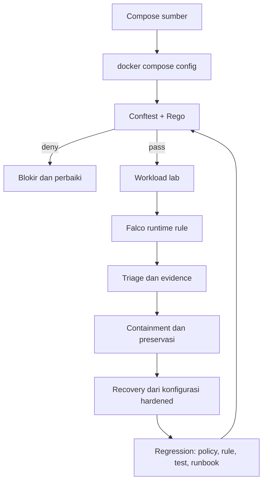

# Cheatsheet Bab 16 — Policy-as-Code, Runtime Security, dan Respons Insiden

Cheatsheet ini mengikuti pola Bab 4–15. Setiap berkas yang harus dibuat ditempatkan dalam **Kotak Script**, sedangkan setup, pengujian, deteksi runtime, pengumpulan evidence, containment, recovery, dan cleanup ditempatkan dalam **Kotak Perintah**. Laboratorium menilai konfigurasi Compose efektif dengan Conftest, mendeteksi shell pada container lab dengan Falco, lalu menjalankan siklus respons insiden sederhana dari triage sampai regression control.

> **Batas otorisasi dan lingkungan.** Bagian Falco wajib dijalankan pada VM Linux disposable milik praktikan. Sensor Falco memperoleh capability kernel dan membaca Docker socket; keduanya merupakan akses sensitif. Jangan menjalankan Falco pada Docker Desktop, laptop kerja bersama, server kampus, atau production. Stimulus serangan hanya diarahkan ke container `ch16-runtime-test` yang dibuat sendiri.

> **Koreksi terhadap Bab 16.** Policy pada naskah Bab 16 memakai `svc.read_only != true`. Karena `docker compose config` tidak menuliskan field boolean bernilai `false`, field tersebut tidak ada pada konfigurasi efektif. Ekspresi menjadi *undefined*, rule tidak aktif, dan service tanpa `read_only` lolos gate. Cheatsheet ini memakai `object.get(svc, "read_only", false)`, menambah unit test untuk field yang hilang, menambah satu berkas Compose negatif (`compose.missing-fields.yaml`), dan memindahkan perintah `set -e` ke dalam script agar tidak menutup terminal interaktif. Rule port juga diperbaiki agar port yang tidak dipublikasikan ke host tidak ikut ditolak.

## Hasil Belajar

Setelah praktikum, mahasiswa mampu:

1. menilai konfigurasi Compose efektif, bukan berkas sumber, sebagai input policy;
2. menulis rule Rego yang aman terhadap field yang tidak ada (*undefined*);
3. membuktikan policy melalui unit test, intentional negative test, dan mutation test;
4. menerapkan exception yang sempit, memiliki owner, dan kedaluwarsa;
5. menjalankan Falco dengan capability seminimal mungkin pada VM disposable;
6. membuktikan rule runtime dengan stimulus positif dan kontrol negatif;
7. mengumpulkan evidence dari host tanpa masuk ke container yang diselidiki;
8. melakukan containment dan preservasi dengan catatan waktu serta checksum;
9. memulihkan workload dengan kontrol runtime yang lebih ketat; dan
10. mengubah temuan insiden menjadi regression control.

## Alur Praktikum Ringkas



| Lapisan | Kekuatan | Keterbatasan |
| --- | --- | --- |
| Conftest + Rego | menolak konfigurasi berisiko sebelum dijalankan | hanya menilai input yang diberikan; rule dapat mati diam-diam bila input tidak sesuai asumsi |
| Unit test policy | membuktikan setiap rule dapat aktif dan dapat lulus | hanya mencakup kasus yang ditulis |
| Falco | mengamati perilaku aktual proses dan container | butuh akses kernel; coverage terbatas pada rule yang dimuat |
| Evidence Docker | cepat untuk triage dan timeline lokal | bukan pengganti audit log host atau forensik memori |
| Recovery hardened | mengurangi peluang pengulangan | tidak menghapus root cause bila credential atau image sudah terkompromi |

## Versi Baseline

Versi berikut mengikuti naskah Bab 16 dan belum diverifikasi ulang untuk cheatsheet ini. Periksa release, signature, dan digest image sebelum dipakai pada semester berjalan, lalu catat hasilnya pada laporan.

| Komponen | Versi/tag | Fungsi |
| --- | --- | --- |
| Conftest | `openpolicyagent/conftest:v0.69.0` | evaluasi dan unit test policy Rego |
| Falco | `falcosecurity/falco:0.44.1` | deteksi runtime berbasis system call |
| Alpine | `alpine:3.23.4` | workload uji |
| Docker Engine + Compose v2 | versi host lab | render konfigurasi efektif dan runtime |

## Kotak Perintah A — Menyiapkan Direktori Bab 16

```bash
$ mkdir -p ~/docker-lab/bab-16/{policy,falco,scripts,incident,evidence}
$ cd ~/docker-lab/bab-16
$ touch evidence/.gitkeep
$ docker version --format '{{.Server.Version}}' | tee evidence/docker-version.txt
$ docker compose version | tee evidence/compose-version.txt
$ uname -r | tee evidence/kernel-version.txt
```

## Kotak Script 1 — File `.gitignore`

```bash
$ nano .gitignore
```

```gitignore
effective.*.yaml
evidence/*
!evidence/.gitkeep
```

Konfigurasi efektif dan evidence dibuat ulang setiap praktikum sehingga tidak dikomit. Laporan cukup memuat checksum dan cuplikan yang relevan.

## Kotak Script 2 — File `compose.insecure.yaml`

```bash
$ nano compose.insecure.yaml
```

```yaml
services:
  app:
    image: alpine:3.23.4
    command: ["sleep", "600"]
    privileged: true
    read_only: false
    ports:
      - "8080:8080"
```

Berkas ini sengaja tidak aman dan hanya dipakai sebagai input negative test. Jangan menjalankannya dengan `docker compose up`.

## Kotak Script 3 — File `compose.hardened.yaml`

```bash
$ nano compose.hardened.yaml
```

```yaml
services:
  app:
    image: alpine:3.23.4
    command: ["sleep", "600"]
    user: "65534:65534"
    read_only: true
    cap_drop: ["ALL"]
    security_opt:
      - no-new-privileges:true
    pids_limit: 64
    tmpfs:
      - /tmp:rw,noexec,nosuid,size=16m
    ports:
      - "127.0.0.1:8080:8080"
```

## Kotak Script 4 — File `compose.missing-fields.yaml`

```bash
$ nano compose.missing-fields.yaml
```

```yaml
services:
  app:
    image: alpine:3.23.4
    command: ["sleep", "600"]
    user: "65534:65534"
    cap_drop: ["ALL"]
    security_opt:
      - no-new-privileges:true
    ports:
      - "127.0.0.1:8080:8080"
```

Berkas ini identik dengan versi hardened, kecuali `read_only` tidak ditulis. Inilah kasus yang lolos pada policy naskah Bab 16. Gate yang benar harus menolaknya dengan pesan `[read-only-rootfs]`.

## Kotak Script 5 — File `policy/compose.rego`

```bash
$ nano policy/compose.rego
```

```rego
package main

import rego.v1

violations contains v if {
	some name, svc in input.services
	object.get(svc, "privileged", false) == true
	v := {"service": name, "rule": "no-privileged", "msg": "privileged dilarang"}
}

violations contains v if {
	some name, svc in input.services
	object.get(svc, "read_only", false) != true
	v := {"service": name, "rule": "read-only-rootfs", "msg": "root filesystem wajib read_only: true"}
}

violations contains v if {
	some name, svc in input.services
	not "ALL" in object.get(svc, "cap_drop", [])
	v := {"service": name, "rule": "cap-drop-all", "msg": "cap_drop wajib memuat ALL"}
}

violations contains v if {
	some name, svc in input.services
	not "no-new-privileges:true" in object.get(svc, "security_opt", [])
	v := {"service": name, "rule": "no-new-privileges", "msg": "security_opt wajib memuat no-new-privileges:true"}
}

violations contains v if {
	some name, svc in input.services
	some port in object.get(svc, "ports", [])
	published_outside_loopback(port)
	v := {"service": name, "rule": "loopback-ports", "msg": "port yang dipublikasikan wajib bind ke 127.0.0.1"}
}

violations contains v if {
	some name, svc in input.services
	object.get(svc, "network_mode", "") == "host"
	v := {"service": name, "rule": "no-host-network", "msg": "network_mode host dilarang"}
}

violations contains v if {
	some name, svc in input.services
	object.get(svc, "pid", "") == "host"
	v := {"service": name, "rule": "no-host-pid", "msg": "pid host dilarang"}
}

violations contains v if {
	some name, svc in input.services
	some vol in object.get(svc, "volumes", [])
	contains(volume_source(vol), "docker.sock")
	v := {"service": name, "rule": "no-docker-socket", "msg": "mount Docker socket dilarang"}
}

published_outside_loopback(port) if {
	is_string(port)
	contains(port, ":")
	not startswith(port, "127.0.0.1:")
}

published_outside_loopback(port) if {
	is_object(port)
	object.get(port, "published", "") != ""
	object.get(port, "host_ip", "") != "127.0.0.1"
}

volume_source(vol) := vol if is_string(vol)

volume_source(vol) := object.get(vol, "source", "") if is_object(vol)

default exceptions := []

exceptions := data.exceptions

today := sprintf("%04d-%02d-%02d", time.date(time.now_ns()))

valid_date(d) if regex.match(`^[0-9]{4}-[0-9]{2}-[0-9]{2}$`, d)

excepted(v) if {
	some e in exceptions
	e.service == v.service
	e.rule == v.rule
	valid_date(e.expires)
	e.expires > today
}

deny contains msg if {
	some v in violations
	not excepted(v)
	msg := sprintf("service %s [%s]: %s", [v.service, v.rule, v.msg])
}

warn contains msg if {
	some v in violations
	excepted(v)
	msg := sprintf("service %s [%s]: dikecualikan sementara; tinjau sebelum expiry", [v.service, v.rule])
}

warn contains msg if {
	some name, svc in input.services
	not non_root_user(object.get(svc, "user", ""))
	msg := sprintf("service %s [non-root-user]: tetapkan user non-root numerik, misalnya 65534:65534", [name])
}

non_root_user(u) if {
	u != ""
	uid := split(u, ":")[0]
	not uid in {"0", "root"}
}
```

Catatan desain:

- Setiap akses field memakai `object.get(..., default)` sehingga field yang tidak ada tetap dinilai, bukan menjadi *undefined*.
- Setiap pelanggaran memiliki `rule` stabil. Identifier ini dipakai oleh pesan, exception, dan pengecekan otomatis pada script gate.
- Exception dibaca dari `data.exceptions` dengan nilai default kosong. Jangan menulis `object.get(data, ...)`, karena mereferensikan seluruh `data` dari dalam package `main` menimbulkan rekursi terhadap rule `deny` itu sendiri.
- Expiry memakai format `YYYY-MM-DD` dan dibandingkan dengan tanggal UTC. Format yang salah membuat exception tidak berlaku, sehingga kesalahan isian bersifat fail-closed.
- User non-root diperlakukan sebagai `warn`, bukan `deny`, agar mahasiswa melihat perbedaan rollout visibility dan blocking yang dibahas pada Bab 16.

## Kotak Script 6 — File `policy/compose_test.rego`

```bash
$ nano policy/compose_test.rego
```

```rego
package main

import rego.v1

hardened := {"services": {"app": {
	"user": "65534:65534",
	"read_only": true,
	"cap_drop": ["ALL"],
	"security_opt": ["no-new-privileges:true"],
	"ports": [{"mode": "ingress", "host_ip": "127.0.0.1", "target": 8080, "published": "8080", "protocol": "tcp"}],
}}}

test_hardened_allowed if {
	count(deny) == 0 with input as hardened
}

test_hardened_without_warning if {
	count(warn) == 0 with input as hardened
}

test_privileged_denied if {
	some msg in deny with input as {"services": {"app": object.union(hardened.services.app, {"privileged": true})}}
	contains(msg, "[no-privileged]")
}

test_missing_read_only_denied if {
	some msg in deny with input as {"services": {"app": object.remove(hardened.services.app, ["read_only"])}}
	contains(msg, "[read-only-rootfs]")
}

test_read_only_false_denied if {
	some msg in deny with input as {"services": {"app": object.union(hardened.services.app, {"read_only": false})}}
	contains(msg, "[read-only-rootfs]")
}

test_missing_cap_drop_denied if {
	some msg in deny with input as {"services": {"app": object.remove(hardened.services.app, ["cap_drop"])}}
	contains(msg, "[cap-drop-all]")
}

test_missing_security_opt_denied if {
	some msg in deny with input as {"services": {"app": object.remove(hardened.services.app, ["security_opt"])}}
	contains(msg, "[no-new-privileges]")
}

test_long_port_without_host_ip_denied if {
	svc := object.union(hardened.services.app, {"ports": [{"mode": "ingress", "target": 8080, "published": "8080", "protocol": "tcp"}]})
	some msg in deny with input as {"services": {"app": svc}}
	contains(msg, "[loopback-ports]")
}

test_short_port_all_interfaces_denied if {
	svc := object.union(hardened.services.app, {"ports": ["8080:8080"]})
	some msg in deny with input as {"services": {"app": svc}}
	contains(msg, "[loopback-ports]")
}

test_unpublished_port_allowed if {
	svc := object.union(hardened.services.app, {"ports": [{"mode": "ingress", "target": 8080, "protocol": "tcp"}]})
	count(deny) == 0 with input as {"services": {"app": svc}}
}

test_host_network_denied if {
	some msg in deny with input as {"services": {"app": object.union(hardened.services.app, {"network_mode": "host"})}}
	contains(msg, "[no-host-network]")
}

test_docker_socket_long_syntax_denied if {
	svc := object.union(hardened.services.app, {"volumes": [{"type": "bind", "source": "/var/run/docker.sock", "target": "/var/run/docker.sock"}]})
	some msg in deny with input as {"services": {"app": svc}}
	contains(msg, "[no-docker-socket]")
}

test_root_user_warned if {
	some msg in warn with input as {"services": {"app": object.union(hardened.services.app, {"user": "0"})}}
	contains(msg, "[non-root-user]")
}

privileged_input := {"services": {"app": object.union(hardened.services.app, {"privileged": true})}}

test_valid_exception_suppresses_deny if {
	exc := [{"service": "app", "rule": "no-privileged", "owner": "lab", "reason": "uji", "expires": "2099-12-31"}]
	count(deny) == 0 with input as privileged_input with data.exceptions as exc
	count(warn) == 1 with input as privileged_input with data.exceptions as exc
}

test_expired_exception_still_denied if {
	exc := [{"service": "app", "rule": "no-privileged", "owner": "lab", "reason": "uji", "expires": "2020-01-01"}]
	count(deny) == 1 with input as privileged_input with data.exceptions as exc
}

test_exception_is_scoped_to_rule if {
	exc := [{"service": "app", "rule": "cap-drop-all", "owner": "lab", "reason": "uji", "expires": "2099-12-31"}]
	count(deny) == 1 with input as privileged_input with data.exceptions as exc
}

test_malformed_expiry_still_denied if {
	exc := [{"service": "app", "rule": "no-privileged", "owner": "lab", "reason": "uji", "expires": "31-12-2099"}]
	count(deny) == 1 with input as privileged_input with data.exceptions as exc
}
```

Unit test mencakup jalur allow, setiap rule deny, field yang hilang, dua bentuk sintaks port, exception yang berlaku, kedaluwarsa, salah format, serta exception yang tidak boleh melebar ke rule lain.

## Kotak Script 7 — File `policy/exceptions.yaml`

```bash
$ nano policy/exceptions.yaml
```

```yaml
# Exception wajib sempit: satu service, satu rule, owner, alasan, dan expiry.
# Contoh format (jangan diaktifkan tanpa approval):
# exceptions:
#   - service: app
#     rule: loopback-ports
#     owner: platform-team
#     reason: demo port publik pada VM terisolasi
#     approved_by: dosen-pengampu
#     expires: "2026-12-31"
exceptions: []
```

## Kotak Script 8 — File `scripts/policy-gate.sh`

```bash
$ nano scripts/policy-gate.sh
```

```bash
#!/usr/bin/env bash
set -euo pipefail

CONFTEST_IMAGE="${CONFTEST_IMAGE:-openpolicyagent/conftest:v0.69.0}"
OUT=evidence/policy
mkdir -p "$OUT"
: > "$OUT/return-codes.txt"

conftest() {
  docker run --rm -v "$PWD:/project" -w /project "$CONFTEST_IMAGE" "$@"
}

for variant in insecure hardened missing-fields; do
  docker compose -f "compose.${variant}.yaml" config > "effective.${variant}.yaml"
done

conftest verify --policy policy | tee "$OUT/verify.txt"

conftest test effective.hardened.yaml --policy policy \
  --data policy/exceptions.yaml --no-color | tee "$OUT/effective.hardened.txt"

expect_deny() {
  local input=$1; shift
  local report rc
  report="$OUT/$(basename "$input" .yaml).txt"
  set +e
  conftest test "$input" --policy policy --data policy/exceptions.yaml \
    --no-color > "$report" 2>&1
  rc=$?
  set -e
  echo "$input rc=$rc" | tee -a "$OUT/return-codes.txt"
  if [ "$rc" -eq 0 ]; then
    echo "FAIL: $input seharusnya ditolak"
    exit 1
  fi
  for rule in "$@"; do
    if ! grep -q "\[$rule\]" "$report"; then
      echo "FAIL: pesan [$rule] tidak muncul pada $input"
      exit 1
    fi
  done
}

expect_deny effective.insecure.yaml \
  no-privileged read-only-rootfs cap-drop-all no-new-privileges loopback-ports
expect_deny effective.missing-fields.yaml read-only-rootfs

sha256sum policy/*.rego policy/exceptions.yaml effective.*.yaml \
  > "$OUT/inputs.sha256"
echo "PASS: policy gate Bab 16"
```

Script gagal bila konfigurasi negatif lolos **atau** bila pesan rule yang diharapkan tidak muncul. Pengecekan kedua penting: gate yang menolak karena alasan lain dapat menyembunyikan rule yang sebenarnya tidak pernah aktif.

## Kotak Script 9 — File `falco/ch16_rules.yaml`

```bash
$ nano falco/ch16_rules.yaml
```

```yaml
- rule: Ch16 Shell Spawned in Lab Container
  desc: Mendeteksi shell yang dijalankan pada container lab Bab 16
  condition: >
    container and spawned_process and
    proc.name in (bash, sh) and
    container.name = ch16-runtime-test
  output: >
    CH16 shell | user=%user.name uid=%user.uid proc=%proc.name
    parent=%proc.pname cmd=%proc.cmdline
    container=%container.name image=%container.image.repository
  priority: NOTICE
  tags: [ch16, container, process, mitre_execution]
```

Rule sengaja dibatasi pada satu nama container agar praktikum tidak menghasilkan noise dari workload lain di VM.

## Kotak Script 10 — File `scripts/falco-start.sh`

```bash
$ nano scripts/falco-start.sh
```

```bash
#!/usr/bin/env bash
set -euo pipefail

FALCO_IMAGE="${FALCO_IMAGE:-falcosecurity/falco:0.44.1}"

docker rm -f ch16-falco >/dev/null 2>&1 || true
docker run -d --name ch16-falco \
  --cap-drop all \
  --cap-add sys_admin \
  --cap-add sys_resource \
  --cap-add sys_ptrace \
  -v /sys/kernel/tracing:/sys/kernel/tracing:ro \
  -v /var/run/docker.sock:/host/var/run/docker.sock \
  -v /proc:/host/proc:ro \
  -v /etc:/host/etc:ro \
  -v "$PWD/falco/ch16_rules.yaml:/etc/falco/rules.d/ch16_rules.yaml:ro" \
  "$FALCO_IMAGE"

echo "Menunggu Falco siap..."
sleep 15
docker logs --tail 30 ch16-falco 2>&1 | tee evidence/falco-startup.log
docker image inspect "$FALCO_IMAGE" --format '{{index .RepoDigests 0}}' \
  | tee evidence/falco-image.txt
```

Periksa `evidence/falco-startup.log`: rule `ch16_rules.yaml` harus termuat dan tidak ada error driver. Bila container langsung berhenti, lihat bagian troubleshooting sebelum menambah capability.

## Kotak Script 11 — File `scripts/runtime-stimulus.sh`

```bash
$ nano scripts/runtime-stimulus.sh
```

```bash
#!/usr/bin/env bash
set -euo pipefail

OUT=evidence/runtime
mkdir -p "$OUT"
count() { docker logs ch16-falco 2>&1 | grep -c 'CH16 shell' || true; }

docker rm -f ch16-runtime-test >/dev/null 2>&1 || true
docker run -d --name ch16-runtime-test alpine:3.23.4 sleep 600
sleep 5
BASELINE=$(count)

echo "Kontrol negatif: mengamati 20 detik tanpa stimulus"
sleep 20
NEGATIVE=$(count)

date -u +%FT%TZ | tee "$OUT/stimulus-utc.txt"
docker exec ch16-runtime-test sh -c 'id; touch /tmp/ch16-probe'
sleep 5
POSITIVE=$(count)

docker logs ch16-falco 2>&1 | grep 'CH16 shell' > "$OUT/falco-ch16-events.txt" || true
printf 'baseline=%s negative_window=%s after_stimulus=%s\n' \
  "$BASELINE" "$NEGATIVE" "$POSITIVE" | tee "$OUT/counts.txt"

if [ "$NEGATIVE" -ne "$BASELINE" ]; then
  echo "FAIL: rule terpicu tanpa stimulus (noise)"
  exit 1
fi
if [ "$POSITIVE" -le "$NEGATIVE" ]; then
  echo "FAIL: stimulus shell tidak terdeteksi"
  exit 1
fi
echo "PASS: deteksi positif dan kontrol negatif sesuai"
```

Perintah `docker exec` di sini adalah stimulus terotorisasi sebelum insiden simulasi dimulai. Setelah alert dianggap insiden, tim tidak lagi masuk ke container; seluruh pengumpulan dilakukan dari host.

## Kotak Script 12 — File `scripts/collect-evidence.sh`

```bash
$ nano scripts/collect-evidence.sh
```

```bash
#!/usr/bin/env bash
set -euo pipefail

TARGET="${1:-ch16-runtime-test}"
INCIDENT_ID="CH16-$(date -u +%Y%m%dT%H%M%SZ)"
DIR="evidence/$INCIDENT_ID"
mkdir -p "$DIR"
echo "$DIR" > evidence/incident-current.txt

date -u +%FT%TZ > "$DIR/collection-start-utc.txt"
whoami > "$DIR/collector.txt"
docker inspect "$TARGET" > "$DIR/container-inspect.json"
docker logs --timestamps "$TARGET" > "$DIR/container.log" 2>&1
docker top "$TARGET" -eo pid,ppid,user,lstart,args > "$DIR/container-top.txt"
docker stats --no-stream "$TARGET" > "$DIR/container-stats.txt"
docker diff "$TARGET" > "$DIR/container-diff.txt"

IMAGE_ID=$(docker inspect -f '{{.Image}}' "$TARGET")
docker image inspect "$IMAGE_ID" > "$DIR/image-inspect.json"
docker events --since 30m --until "$(date -u +%FT%TZ)" \
  --filter "container=$TARGET" > "$DIR/docker-events.txt"
docker logs ch16-falco 2>&1 | grep 'CH16 shell' > "$DIR/falco-alerts.txt" || true

date -u +%FT%TZ > "$DIR/collection-end-utc.txt"
find "$DIR" -type f ! -name MANIFEST.sha256 -print0 | sort -z \
  | xargs -0 sha256sum > "$DIR/MANIFEST.sha256"
sha256sum -c "$DIR/MANIFEST.sha256"
echo "Evidence tersimpan di $DIR"
```

`docker diff` seharusnya menampilkan `/tmp/ch16-probe`. Temuan itu menghubungkan alert Falco dengan perubahan filesystem tanpa perlu menjalankan perintah di dalam container.

## Kotak Script 13 — File `scripts/contain.sh`

```bash
$ nano scripts/contain.sh
```

```bash
#!/usr/bin/env bash
set -euo pipefail

TARGET="${1:-ch16-runtime-test}"
DIR=$(cat evidence/incident-current.txt)

docker inspect -f '{{json .NetworkSettings.Networks}}' "$TARGET" \
  > "$DIR/networks-before-containment.json"
for net in $(docker inspect -f '{{range $k, $v := .NetworkSettings.Networks}}{{$k}} {{end}}' "$TARGET"); do
  docker network disconnect "$net" "$TARGET"
done
date -u +%FT%TZ > "$DIR/containment-utc.txt"
docker inspect -f '{{json .NetworkSettings.Networks}}' "$TARGET" \
  > "$DIR/networks-after-containment.json"

docker stop "$TARGET"
docker export "$TARGET" -o "$DIR/container-filesystem.tar"
docker rm "$TARGET"
date -u +%FT%TZ > "$DIR/preserved-and-removed-utc.txt"

find "$DIR" -type f ! -name MANIFEST.sha256 -print0 | sort -z \
  | xargs -0 sha256sum > "$DIR/MANIFEST.sha256"
sha256sum -c "$DIR/MANIFEST.sha256"
```

Script memutus semua network yang terpasang, bukan hanya `bridge`, lalu mengekspor filesystem sebelum container dihapus. `networks-after-containment.json` harus berisi `{}`. Ekspor filesystem tidak memuat memori proses; batas ini wajib dicatat pada laporan.

## Kotak Script 14 — File `scripts/recover.sh`

```bash
$ nano scripts/recover.sh
```

```bash
#!/usr/bin/env bash
set -euo pipefail

CONFTEST_IMAGE="${CONFTEST_IMAGE:-openpolicyagent/conftest:v0.69.0}"
DIR=$(cat evidence/incident-current.txt)

docker compose -f compose.hardened.yaml config > effective.recovery.yaml
docker run --rm -v "$PWD:/project" -w /project "$CONFTEST_IMAGE" \
  test effective.recovery.yaml --policy policy --data policy/exceptions.yaml \
  --no-color | tee "$DIR/recovery-policy.txt"

docker rm -f ch16-runtime-clean >/dev/null 2>&1 || true
docker run -d --name ch16-runtime-clean \
  --network none \
  --read-only \
  --tmpfs /tmp:rw,noexec,nosuid,size=16m \
  --user 65534:65534 \
  --cap-drop ALL \
  --security-opt no-new-privileges:true \
  --pids-limit 64 \
  alpine:3.23.4 sleep 600

test "$(docker inspect -f '{{.State.Running}}' ch16-runtime-clean)" = true
test "$(docker inspect -f '{{.HostConfig.ReadonlyRootfs}}' ch16-runtime-clean)" = true
test "$(docker inspect -f '{{.Config.User}}' ch16-runtime-clean)" = "65534:65534"
docker inspect -f '{{json .HostConfig.CapDrop}} {{json .HostConfig.SecurityOpt}}' \
  ch16-runtime-clean | tee "$DIR/recovery-runtime.txt"
date -u +%FT%TZ > "$DIR/recovery-utc.txt"

find "$DIR" -type f ! -name MANIFEST.sha256 -print0 | sort -z \
  | xargs -0 sha256sum > "$DIR/MANIFEST.sha256"
echo "PASS: workload pulih dari konfigurasi yang lolos policy"
```

## Kotak Script 15 — File `incident/incident-record.md`

```bash
$ nano incident/incident-record.md
```

```markdown
# Catatan Insiden Simulasi Bab 16

| Butir | Isi |
| --- | --- |
| Incident ID | CH16-... (lihat evidence/incident-current.txt) |
| Severity | Rendah/Sedang/Tinggi beserta alasan |
| Incident commander | |
| Waktu deteksi (UTC) | |
| Waktu containment (UTC) | |
| Waktu recovery (UTC) | |

## Ringkasan
Apa yang terjadi, aset apa yang terdampak, dan bagaimana dampak dibatasi.

## Timeline
| Waktu UTC | Peristiwa | Sumber evidence | Pelaksana |
| --- | --- | --- | --- |

## Validasi alert
Mengapa alert dinilai sah atau false positive; korelasi dengan docker diff dan docker events.

## Keputusan containment
Alasan, dampak yang diperkirakan, approval simulasi, dan state yang mungkin berubah.

## Root cause dan contributing factors

## Kontrol yang bekerja dan yang gagal

## Tindakan korektif
| Tindakan | Jenis (policy/rule/test/runbook/desain) | Owner | Due date | Closure evidence |
| --- | --- | --- | --- | --- |

## Residual risk dan keterbatasan evidence
```

## Kotak Perintah B — Menyiapkan Script dan Image

```bash
$ chmod +x scripts/*.sh
$ docker pull openpolicyagent/conftest:v0.69.0
$ docker pull alpine:3.23.4
$ docker image inspect openpolicyagent/conftest:v0.69.0 \
    --format '{{index .RepoDigests 0}}' | tee evidence/conftest-image.txt
$ docker image inspect alpine:3.23.4 \
    --format '{{index .RepoDigests 0}}' | tee evidence/alpine-image.txt
```

## Kotak Perintah C — Unit Test dan Policy Gate

```bash
$ docker run --rm -v "$PWD:/project" -w /project \
    openpolicyagent/conftest:v0.69.0 verify --policy policy
$ ./scripts/policy-gate.sh
$ cat evidence/policy/return-codes.txt
$ grep -n 'read_only' effective.insecure.yaml || echo "read_only tidak ada pada konfigurasi efektif"
```

Perintah terakhir menunjukkan akar bug naskah: `read_only: false` hilang setelah render. Karena itu policy wajib diuji terhadap konfigurasi efektif dan wajib menangani field yang tidak ada.

## Kotak Perintah D — Mutation Test

```bash
$ sed '/cap_drop/d' compose.hardened.yaml > compose.mutant.yaml
$ docker compose -f compose.mutant.yaml config > effective.mutant.yaml
$ docker run --rm -v "$PWD:/project" -w /project \
    openpolicyagent/conftest:v0.69.0 test effective.mutant.yaml \
    --policy policy --data policy/exceptions.yaml --no-color \
    | tee evidence/policy/mutant.txt; echo "rc=${PIPESTATUS[0]}"
$ grep -q '\[cap-drop-all\]' evidence/policy/mutant.txt && echo "PASS: mutan terdeteksi"
$ rm compose.mutant.yaml effective.mutant.yaml
```

Ulangi dengan menghapus `security_opt` atau mengganti `127.0.0.1:8080:8080` menjadi `8080:8080`. Setiap mutasi harus memicu rule yang bersesuaian; mutasi yang lolos menandakan blind spot policy.

## Kotak Perintah E — Uji Exception

```bash
$ cp policy/exceptions.yaml policy/exceptions.yaml.bak
$ cat > policy/exceptions.yaml <<'YAML'
exceptions:
  - service: app
    rule: loopback-ports
    owner: platform-team
    reason: uji exception praktikum
    approved_by: dosen-pengampu
    expires: "2099-12-31"
YAML
$ docker run --rm -v "$PWD:/project" -w /project \
    openpolicyagent/conftest:v0.69.0 test effective.insecure.yaml \
    --policy policy --data policy/exceptions.yaml --no-color \
    | tee evidence/policy/exception-active.txt
$ sed -i 's/2099-12-31/2020-01-01/' policy/exceptions.yaml
$ docker run --rm -v "$PWD:/project" -w /project \
    openpolicyagent/conftest:v0.69.0 test effective.insecure.yaml \
    --policy policy --data policy/exceptions.yaml --no-color \
    | tee evidence/policy/exception-expired.txt
$ mv policy/exceptions.yaml.bak policy/exceptions.yaml
```

Pada percobaan pertama, `[loopback-ports]` berpindah dari failure menjadi warning, sedangkan rule lain tetap gagal. Pada percobaan kedua, exception kedaluwarsa dan `[loopback-ports]` kembali menjadi failure.

## Kotak Perintah F — Menjalankan Falco (Terminal 1, VM Disposable)

```bash
$ ./scripts/falco-start.sh
$ docker logs -f ch16-falco
```

Biarkan Terminal 1 menampilkan log Falco selama praktikum.

## Kotak Perintah G — Stimulus dan Kontrol Negatif (Terminal 2)

```bash
$ cd ~/docker-lab/bab-16
$ ./scripts/runtime-stimulus.sh
$ cat evidence/runtime/falco-ch16-events.txt
```

## Kotak Perintah H — Triage dan Evidence

```bash
$ ./scripts/collect-evidence.sh
$ DIR=$(cat evidence/incident-current.txt)
$ cat "$DIR/container-diff.txt"
$ cat "$DIR/falco-alerts.txt"
```

Isi `incident/incident-record.md` mulai dari bagian timeline dan validasi alert sebelum melanjutkan ke containment.

## Kotak Perintah I — Containment dan Preservasi

```bash
$ ./scripts/contain.sh
$ DIR=$(cat evidence/incident-current.txt)
$ cat "$DIR/networks-after-containment.json"
$ tar -tf "$DIR/container-filesystem.tar" | grep 'tmp/ch16-probe'
$ sha256sum -c "$DIR/MANIFEST.sha256"
```

## Kotak Perintah J — Recovery dan Regression

```bash
$ ./scripts/recover.sh
$ ./scripts/policy-gate.sh
```

Menjalankan ulang policy gate setelah recovery membuktikan bahwa kontrol yang mencegah pengulangan tetap aktif. Lengkapi bagian tindakan korektif pada catatan insiden: minimal satu perubahan policy, rule, test, atau runbook beserta owner dan closure evidence.

## Kriteria PASS/FAIL

| ID | Pengujian | PASS bila | Evidence |
| --- | --- | --- | --- |
| T16-01 | Unit test policy | Seluruh test Rego lulus. | `conftest verify` dan `evidence/policy/verify.txt` |
| T16-02 | Positive policy | `effective.hardened.yaml` exit code 0 tanpa failure. | `evidence/policy/effective.hardened.txt` |
| T16-03 | Intentional negative | `effective.insecure.yaml` ditolak dengan lima pesan rule. | `evidence/policy/return-codes.txt` |
| T16-04 | Field hilang | `effective.missing-fields.yaml` ditolak dengan `[read-only-rootfs]`. | `evidence/policy/effective.missing-fields.txt` |
| T16-05 | Mutation | Setiap mutasi memicu rule yang bersesuaian. | `evidence/policy/mutant.txt` |
| T16-06 | Exception | Exception aktif hanya menekan satu rule; exception kedaluwarsa tidak berlaku. | `exception-active.txt`, `exception-expired.txt` |
| T16-07 | Runtime positif | Rule `CH16 shell` terpicu setelah stimulus. | `evidence/runtime/counts.txt` |
| T16-08 | Runtime negatif | Tidak ada alert selama jendela tanpa stimulus. | `evidence/runtime/counts.txt` |
| T16-09 | Evidence integrity | `sha256sum -c` lulus pada manifest insiden. | `MANIFEST.sha256` |
| T16-10 | Containment | Network kosong dan filesystem terekspor sebelum container dihapus. | `networks-after-containment.json`, `container-filesystem.tar` |
| T16-11 | Recovery | Workload baru berjalan read-only, non-root, tanpa capability, dan lolos policy. | `recovery-policy.txt`, `recovery-runtime.txt` |

## Troubleshooting Cepat

| Gejala | Pemeriksaan | Penyebab umum | Tindakan |
| --- | --- | --- | --- |
| `conftest verify` gagal parse | baca baris error | sintaks Rego v1, tab/spasi campur, atau `import rego.v1` hilang | samakan dengan Kotak Script 5–6 |
| Konfigurasi negatif lolos | `cat effective.insecure.yaml` | rule membaca field yang tidak ada tanpa default | gunakan `object.get(svc, field, default)` dan tambah unit test field hilang |
| Pesan rule tertentu tidak muncul | `grep '\[' evidence/policy/*.txt` | rule *undefined* atau identifier berbeda | samakan identifier `rule` pada policy dan script |
| Exception tidak berlaku | periksa format `expires` | format bukan `YYYY-MM-DD` atau tanggal sudah lewat | perbaiki format; perpanjang hanya dengan approval baru |
| `rego_recursion_error` | cari `object.get(data` | seluruh `data` direferensikan dari package `main` | baca `data.exceptions` langsung dengan `default` |
| Falco berhenti saat start | `docker logs ch16-falco` | kernel tidak mendukung modern eBPF atau tracefs tidak tersedia | catat versi kernel; ikuti panduan driver Falco untuk kernel tersebut; jangan langsung memakai `--privileged` |
| Rule termuat tetapi tidak terpicu | `docker logs ch16-falco \| grep -i ch16` | nama container berbeda atau metadata container tidak tersedia | pastikan nama `ch16-runtime-test`; periksa log metadata container Falco |
| Kontrol negatif gagal | lihat isi `falco-ch16-events.txt` | ada shell lain yang dijalankan ke container yang sama | hentikan aktivitas lain; ulangi pengamatan |
| `docker network disconnect` gagal | `docker inspect` network | container sudah berhenti atau network sudah terputus | catat kondisi aktual pada timeline; jangan mengulang tindakan tanpa pencatatan |
| `sha256sum -c` gagal | bandingkan isi direktori | berkas ditambah setelah manifest dibuat | jalankan ulang pembuatan manifest pada akhir setiap tahap dan catat alasannya |

## Kotak Perintah K — Cleanup Aman

```bash
$ docker rm -f ch16-runtime-clean ch16-runtime-test ch16-falco 2>/dev/null || true
$ rm -f effective.*.yaml
$ find evidence -type f -print | sort
```

Evidence tidak dihapus sampai laporan dinilai. Pastikan tidak ada credential, token, atau data pribadi pada berkas evidence sebelum dikumpulkan.

## Integrasi dengan Bab Sebelumnya

- **Bab 8:** baseline hardening runtime (`read_only`, `cap_drop`, `no-new-privileges`) di sini menjadi rule yang dapat dijalankan, bukan hanya rekomendasi.
- **Bab 10:** `scripts/policy-gate.sh` dapat dipasang sebagai step pipeline sebelum deploy; exit code non-zero menghentikan promosi.
- **Bab 11:** setiap rule dapat ditautkan ke threat dan security requirement, misalnya Elevation of Privilege untuk `no-privileged`.
- **Bab 14:** recovery seharusnya memakai image berbasis digest yang signature-nya telah diverifikasi; praktikum ini memakai tag Alpine demi kesederhanaan.
- **Bab 17:** policy gate, rule Falco, dan catatan insiden menjadi bagian evidence capstone pada gate Deploy dan Runtime.

## Catatan Interpretasi

PASS pada policy gate berarti konfigurasi efektif yang diuji tidak melanggar rule pada versi policy tersebut. PASS bukan bukti bahwa workload aman secara keseluruhan; rule hanya mencakup properti yang ditulis. Satu alert Falco juga bukan bukti kompromi, dan ketiadaan alert bukan bukti tidak ada aktivitas berbahaya di luar cakupan rule. Evidence Docker berguna untuk triage dan timeline lokal, tetapi tidak menggantikan audit log host, forensik memori, atau sistem logging dengan retensi panjang.

Logika policy pada cheatsheet ini, termasuk kasus field hilang dan exception, telah diuji terhadap seluruh kasus unit test. Perilaku Conftest, Falco, driver kernel, dan metadata container tetap bergantung pada versi alat serta kernel host, sehingga perlu dicatat dan diverifikasi saat praktikum dijalankan.

## Rujukan Resmi

- [Conftest documentation](https://www.conftest.dev/)
- [OPA policy language (Rego)](https://www.openpolicyagent.org/docs/policy-language)
- [OPA policy testing](https://www.openpolicyagent.org/docs/policy-testing)
- [Falco: deploy as a container](https://falco.org/docs/setup/container/)
- [Falco rules](https://falco.org/docs/concepts/rules/)
- [Falco supported fields](https://falco.org/docs/reference/rules/supported-fields/)
- [Docker Compose services reference](https://docs.docker.com/reference/compose-file/services/)
- [docker container run security options](https://docs.docker.com/reference/cli/docker/container/run/)
- [NIST SP 800-61 Rev. 3](https://doi.org/10.6028/NIST.SP.800-61r3)

## Checklist Akhir

- [ ] Policy dievaluasi terhadap `effective.*.yaml`, bukan berkas Compose sumber.
- [ ] Seluruh unit test Rego lulus, termasuk kasus field hilang dan exception.
- [ ] Konfigurasi insecure dan missing-fields ditolak dengan pesan rule yang tepat.
- [ ] Minimal satu mutation test terdeteksi.
- [ ] Exception memiliki owner, alasan, approval, dan expiry; exception kedaluwarsa tidak berlaku.
- [ ] Falco hanya dijalankan pada VM disposable dengan capability terbatas.
- [ ] Deteksi positif dan kontrol negatif terdokumentasi.
- [ ] Evidence dikumpulkan dari host tanpa masuk ke container yang diselidiki.
- [ ] Network terputus dan filesystem terekspor sebelum container dihapus.
- [ ] Manifest checksum valid.
- [ ] Workload pulih dari konfigurasi yang lolos policy.
- [ ] Catatan insiden memuat timeline, keputusan, tindakan korektif, dan residual risk.
