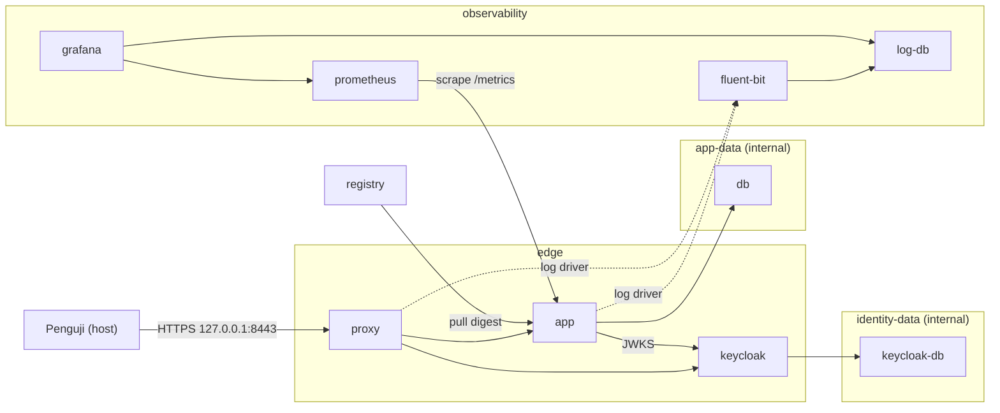

# Cheatsheet Bab 17 — Studi Kasus Terpadu: Platform Web Terkontainerisasi yang Aman dan Teramati

Cheatsheet ini menyatukan Bab 3–16 menjadi satu platform capstone. Setiap berkas ditempatkan dalam **Kotak Script**, sedangkan setup, eksekusi gate, verifikasi, simulasi insiden, dan cleanup ditempatkan dalam **Kotak Perintah**. Hasil akhirnya bukan sekadar stack yang berjalan, melainkan **keputusan rilis berbasis evidence**: delapan gate menghasilkan berkas JSON terverifikasi, lalu `gates/decide.py` memutuskan `RELEASE` atau `HOLD`.

> **Batas otorisasi dan lingkungan.** Jalankan seluruh praktikum pada VM Linux disposable milik kelompok. Gate G7 menjalankan Falco yang membutuhkan capability kernel dan Docker socket. Semua port hanya dipublikasikan ke `127.0.0.1`. Credential dibangkitkan acak oleh script dan tidak boleh dipakai di luar laboratorium.

> **Koreksi terhadap Bab 17.** (1) Rubrik dan checklist naskah hampir hanya menilai materi Bab 1–10; threat model, SBOM, signature, DAST, policy-as-code, dan respons insiden tidak memiliki bobot. Cheatsheet ini memakai rubrik revisi yang memetakan setiap bab ke evidence. (2) Naskah memberi nilai untuk "screenshot cukup", padahal Bab 1 menyatakan screenshot bukan sumber kebenaran; di sini setiap gate menghasilkan evidence mesin dengan checksum. (3) "Blueprint Compose" naskah tidak dapat dijalankan; cheatsheet ini menyediakan Compose lengkap. (4) Gate matriks naskah tidak diimplementasikan; di sini setiap gate memiliki script, kriteria, dan berkas evidence.

## Hasil Belajar

Setelah praktikum, kelompok mampu:

1. merakit platform berlapis: edge, aplikasi, data, identitas, observability, dan registry;
2. memisahkan zona network dan membuktikan segmentasinya melalui policy;
3. memvalidasi token OIDC secara lengkap dan menerapkan otorisasi tingkat objek;
4. menjalankan delapan gate dari source sampai recovery dengan evidence terverifikasi;
5. membuktikan bahwa artefak yang dipindai, ditandatangani, dideploy, dan dipulihkan adalah digest yang sama;
6. mengelola exception dengan owner, alasan, approval, dan expiry;
7. menjalankan simulasi insiden dan uji pemulihan;
8. menyusun keputusan rilis beserta residual risk.

## Arsitektur dan Zona Network



| Zona | Service | Alasan |
| --- | --- | --- |
| `edge` | proxy, app, keycloak | satu-satunya jalur dari pengguna; app mengambil JWKS dari keycloak |
| `app-data` (internal) | app, db | database aplikasi tidak dapat dijangkau dari edge maupun Internet |
| `identity-data` (internal) | keycloak, keycloak-db | data identitas terpisah dari data aplikasi |
| `observability` | app, fluent-bit, log-db, prometheus, grafana | metrik dan log terpisah dari jalur pengguna |
| `registry-net` | registry | registry hanya diakses daemon host untuk push/pull |

## Peta Integrasi Bab

| Bab | Komponen di capstone | Gate | Evidence utama |
| --- | --- | --- | --- |
| 3–5 | Compose multi-network, PostgreSQL, secret file | G6, G8 | `effective.release.yaml`, uji restore |
| 4 | proxy TLS, header keamanan, pembatasan route | G6 | `evidence/deploy/live-security.tsv` |
| 6–7 | Fluent Bit, log-db, Prometheus, Grafana, alert rule | G6, G7 | query log, status target dan alert |
| 8 | hardening runtime dan image non-root | G4, G6 | `image-user.txt`, konfigurasi efektif |
| 9 | Keycloak, service account, audience mapper | G6 | uji token 401/403/404 |
| 10 | pipeline gate berurutan dan fail-closed | semua | `evidence/gates/*.json` |
| 11 | threat model dan keterlacakan | semua | `model/traceability-capstone.csv` |
| 12 | Semgrep, Gitleaks, unit test keamanan | G1, G2 | JUnit, Semgrep JSON, Gitleaks JSON |
| 13 | SBOM dan SCA | G3 | `evidence/sbom/app.cdx.json` |
| 14 | build sekali, digest, provenance, Cosign | G3, G5 | `image-ref.txt`, hasil verify |
| 15 | security regression terhadap stack berjalan | G6 | `live-security.tsv` |
| 16 | Conftest, exception, Falco, respons insiden | G6, G7 | hasil policy, event Falco |

## Versi Baseline

Versi berikut diambil dari cheatsheet Bab 9–16 agar konsisten antarbab. Baris bertanda **perlu verifikasi** belum dipakai di cheatsheet sebelumnya. Periksa release, signature, dan digest semua image sebelum semester berjalan, lalu catat hasil resolusinya pada laporan.

| Komponen | Image/versi | Sumber konsistensi |
| --- | --- | --- |
| Proxy | `nginxinc/nginx-unprivileged:1.29-alpine` | **perlu verifikasi** |
| Python runtime aplikasi | `python:3.11.16-slim` | Bab 10 |
| PostgreSQL | `postgres:16-alpine` | Bab 3, 5, 6 |
| Keycloak | `quay.io/keycloak/keycloak:26.7.2` | Bab 9 |
| Fluent Bit | `fluent/fluent-bit:4.2.8` | Bab 6 |
| Prometheus | `prom/prometheus:v3.14.0` | Bab 7 |
| Grafana | `grafana/grafana:13.1.4` | Bab 7 |
| Registry | `registry:3.1.1` | Bab 10, 14 |
| Gitleaks | `ghcr.io/gitleaks/gitleaks:v8.30.1` | Bab 12 |
| Semgrep | `semgrep/semgrep:1.174.0` | Bab 12 |
| Syft | `anchore/syft:v1.51.0` | Bab 13 |
| Trivy | `aquasec/trivy:0.74.0` | Bab 10, 13 |
| Cosign | `ghcr.io/sigstore/cosign/cosign:v3.1.3` | Bab 14 |
| Conftest | `openpolicyagent/conftest:v0.69.0` | Bab 16 |
| Falco | `falcosecurity/falco:0.44.1` | Bab 16 |
| Paket Python aplikasi | lihat `app/requirements.txt` | versi diperiksa di PyPI saat penulisan |

## Kotak Perintah A — Menyiapkan Direktori Capstone

```bash
$ mkdir -p ~/docker-lab/bab-17/{app,tests,proxy,identity,db/init,log-db/init,fluent-bit,observability/grafana/provisioning/datasources,policy/semgrep,falco,gates,scripts,model,docs,evidence,keys,secrets,certs}
$ cd ~/docker-lab/bab-17
$ git init
$ touch evidence/.gitkeep
$ for t in docker git jq openssl python3 curl; do command -v "$t" >/dev/null || echo "TIDAK ADA: $t"; done
$ docker compose version
```

Seluruh perintah berikutnya dijalankan dari `~/docker-lab/bab-17`.

## Kotak Script 1 — File `.gitignore`

```bash
$ nano .gitignore
```

```gitignore
.env
release.env
secrets/
keys/
certs/
evidence/*
!evidence/.gitkeep
effective.*.yaml
.venv/
__pycache__/
.pytest_cache/
```

## Kotak Script 2 — File `versions.env`

```bash
$ nano versions.env
```

```bash
NGINX_IMAGE=nginxinc/nginx-unprivileged:1.29-alpine
PYTHON_IMAGE=python:3.11.16-slim
POSTGRES_IMAGE=postgres:16-alpine
KEYCLOAK_IMAGE=quay.io/keycloak/keycloak:26.7.2
FLUENTBIT_IMAGE=fluent/fluent-bit:4.2.8
PROMETHEUS_IMAGE=prom/prometheus:v3.14.0
GRAFANA_IMAGE=grafana/grafana:13.1.4
REGISTRY_IMAGE=registry:3.1.1
GITLEAKS_IMAGE=ghcr.io/gitleaks/gitleaks:v8.30.1
SEMGREP_IMAGE=semgrep/semgrep:1.174.0
SYFT_IMAGE=anchore/syft:v1.51.0
TRIVY_IMAGE=aquasec/trivy:0.74.0
COSIGN_IMAGE=ghcr.io/sigstore/cosign/cosign:v3.1.3
CONFTEST_IMAGE=openpolicyagent/conftest:v0.69.0
FALCO_IMAGE=falcosecurity/falco:0.44.1
APP_REPOSITORY=localhost:5000/capstone/api
```

Berkas ini dikomit karena tidak berisi secret. Setelah digest diverifikasi, ganti tag dengan `repository@sha256:...`; policy G6 menerima keduanya, tetapi aplikasi wajib memakai digest.

## Kotak Script 3 — File `dc`

```bash
$ nano dc
```

```bash
#!/usr/bin/env bash
# Wrapper Compose: selalu memuat versi image, secret lokal, dan digest rilis aktif.
cd "$(dirname "$0")" || exit 1
args=(--env-file versions.env --env-file .env)
[ -f release.env ] && args+=(--env-file release.env)
exec docker compose "${args[@]}" "$@"
```

`compose.yaml` mewajibkan `APP_IMAGE` dan versi image, sehingga `docker compose` tanpa env file akan gagal. Gunakan `./dc` untuk semua perintah Compose pada cheatsheet ini, termasuk `./dc ps`, `./dc logs`, dan `./dc exec`.

## Kotak Script 4 — File `scripts/init-secrets.sh`

```bash
$ nano scripts/init-secrets.sh
```

```bash
#!/usr/bin/env bash
set -euo pipefail
cd "$(dirname "$0")/.." || exit 1

rand() { openssl rand -hex 24; }

if [ -e .env ]; then
  echo "SKIP: .env sudah ada; hapus manual bila ingin membangkitkan ulang"
  exit 0
fi

umask 077
mkdir -p secrets certs
KEYCLOAK_DB_PASSWORD=$(rand)
FLUENTBIT_DB_PASSWORD=$(rand)
GRAFANA_LOGDB_PASSWORD=$(rand)

cat > .env <<EOF
CAPSTONE_HOST=capstone.localhost
KC_BOOTSTRAP_ADMIN_USERNAME=kcadmin
KC_BOOTSTRAP_ADMIN_PASSWORD=$(rand)
KEYCLOAK_DB_PASSWORD=$KEYCLOAK_DB_PASSWORD
FLUENTBIT_DB_USER=fluentbit_ingest
FLUENTBIT_DB_PASSWORD=$FLUENTBIT_DB_PASSWORD
GRAFANA_LOGDB_PASSWORD=$GRAFANA_LOGDB_PASSWORD
CAPSTONE_ALICE_SECRET=$(rand)
CAPSTONE_BOB_SECRET=$(rand)
CAPSTONE_ADMIN_SECRET=$(rand)
COSIGN_PASSWORD=$(rand)
EOF

rand > secrets/db_admin_password.txt
rand > secrets/app_db_password.txt
rand > secrets/logdb_admin_password.txt
rand > secrets/grafana_admin_password.txt
printf '%s' "$KEYCLOAK_DB_PASSWORD" > secrets/keycloak_db_password.txt
printf '%s' "$FLUENTBIT_DB_PASSWORD" > secrets/fluentbit_db_password.txt
printf '%s' "$GRAFANA_LOGDB_PASSWORD" > secrets/grafana_logdb_password.txt

# Direktori 0700 melindungi dari pengguna host lain. Berkas 0644 diperlukan
# karena Compose non-Swarm memasang secret sebagai bind mount dengan izin host,
# sedangkan proses container (postgres, app) berjalan dengan UID berbeda.
chmod 700 secrets
chmod 644 secrets/*.txt

openssl req -x509 -newkey rsa:3072 -nodes -days 30 \
  -keyout certs/ca.key -out certs/ca.crt -subj "/CN=Capstone Lab CA"
openssl req -newkey rsa:2048 -nodes \
  -keyout certs/server.key -out certs/server.csr -subj "/CN=capstone.localhost"
printf 'subjectAltName=DNS:capstone.localhost\nextendedKeyUsage=serverAuth\n' > certs/ext.cnf
openssl x509 -req -in certs/server.csr -CA certs/ca.crt -CAkey certs/ca.key \
  -CAcreateserial -days 30 -extfile certs/ext.cnf -out certs/server.crt
chmod 644 certs/server.crt certs/ca.crt certs/server.key
rm certs/server.csr certs/ext.cnf
echo "PASS: .env, secrets/, dan certs/ dibuat"
```

`server.key` dibuat 0644 agar dapat dibaca proses nginx non-root (UID 101). Ini kompromi laboratorium; pada produksi, private key dikelola secret manager dan dipasang dengan kepemilikan yang tepat.

## Kotak Script 5 — File `compose.yaml`

```bash
$ nano compose.yaml
```

```yaml
name: capstone

x-hardening: &hardening
  read_only: true
  cap_drop: ["ALL"]
  security_opt:
    - no-new-privileges:true
  restart: unless-stopped

x-fluentd: &fluentd
  driver: fluentd
  options:
    fluentd-address: "127.0.0.1:24224"
    fluentd-async: "true"
    tag: "capstone.{{.Name}}"

x-postgres-caps: &postgres-caps
  cap_add: ["CHOWN", "DAC_OVERRIDE", "FOWNER", "SETGID", "SETUID"]
  tmpfs:
    - /var/run/postgresql
    - /tmp

services:
  proxy:
    <<: *hardening
    image: ${NGINX_IMAGE}
    user: "101:101"
    ports:
      - "127.0.0.1:8443:8443"
    volumes:
      - ./proxy/nginx.conf:/etc/nginx/conf.d/default.conf:ro
      - ./certs/server.crt:/etc/nginx/certs/server.crt:ro
      - ./certs/server.key:/etc/nginx/certs/server.key:ro
    tmpfs:
      - /tmp
    networks: [edge]
    depends_on:
      app:
        condition: service_healthy
      keycloak:
        condition: service_started
    logging: *fluentd

  app:
    <<: *hardening
    image: ${APP_IMAGE:?APP_IMAGE wajib berupa digest hasil gate G3}
    user: "10001:10001"
    environment:
      OIDC_ISSUER: https://${CAPSTONE_HOST}:8443/auth/realms/capstone
      OIDC_AUDIENCE: capstone-api
      OIDC_JWKS_URL: http://keycloak:8080/auth/realms/capstone/protocol/openid-connect/certs
      DB_HOST: db
      DB_NAME: capstone
      DB_USER: capstone_app
      DB_PASSWORD_FILE: /run/secrets/app_db_password
    secrets: [app_db_password]
    tmpfs:
      - /tmp
    networks: [edge, app-data, observability]
    depends_on:
      db:
        condition: service_healthy
    healthcheck:
      test: ["CMD", "python", "-c", "import urllib.request; urllib.request.urlopen('http://127.0.0.1:8000/health', timeout=2)"]
      interval: 10s
      timeout: 3s
      retries: 6
      start_period: 10s
    logging: *fluentd

  db:
    <<: [*hardening, *postgres-caps]
    image: ${POSTGRES_IMAGE}
    environment:
      POSTGRES_DB: capstone
      POSTGRES_USER: postgres
      POSTGRES_PASSWORD_FILE: /run/secrets/db_admin_password
      APP_DB_PASSWORD_FILE: /run/secrets/app_db_password
    secrets: [db_admin_password, app_db_password]
    volumes:
      - app-db-data:/var/lib/postgresql/data
      - ./db/init:/docker-entrypoint-initdb.d:ro
    networks: [app-data]
    healthcheck:
      test: ["CMD-SHELL", "pg_isready -U postgres -d capstone"]
      interval: 5s
      timeout: 5s
      retries: 12

  keycloak:
    <<: *hardening
    image: ${KEYCLOAK_IMAGE}
    user: "1000:1000"
    read_only: false
    command:
      - start
      - --import-realm
      - --http-enabled=true
      - --http-relative-path=/auth
      - --hostname=https://${CAPSTONE_HOST}:8443/auth
      - --proxy-headers=xforwarded
      - --health-enabled=true
    environment:
      KC_DB: postgres
      KC_DB_URL: jdbc:postgresql://keycloak-db:5432/keycloak
      KC_DB_USERNAME: keycloak
      KC_DB_PASSWORD: ${KEYCLOAK_DB_PASSWORD}
      KC_BOOTSTRAP_ADMIN_USERNAME: ${KC_BOOTSTRAP_ADMIN_USERNAME}
      KC_BOOTSTRAP_ADMIN_PASSWORD: ${KC_BOOTSTRAP_ADMIN_PASSWORD}
      CAPSTONE_ALICE_SECRET: ${CAPSTONE_ALICE_SECRET}
      CAPSTONE_BOB_SECRET: ${CAPSTONE_BOB_SECRET}
      CAPSTONE_ADMIN_SECRET: ${CAPSTONE_ADMIN_SECRET}
    volumes:
      - ./identity/realm-capstone.json:/opt/keycloak/data/import/realm-capstone.json:ro
    networks: [edge, identity-data]
    depends_on:
      keycloak-db:
        condition: service_healthy
    logging: *fluentd

  keycloak-db:
    <<: [*hardening, *postgres-caps]
    image: ${POSTGRES_IMAGE}
    environment:
      POSTGRES_DB: keycloak
      POSTGRES_USER: keycloak
      POSTGRES_PASSWORD_FILE: /run/secrets/keycloak_db_password
    secrets: [keycloak_db_password]
    volumes:
      - keycloak-db-data:/var/lib/postgresql/data
    networks: [identity-data]
    healthcheck:
      test: ["CMD-SHELL", "pg_isready -U keycloak -d keycloak"]
      interval: 5s
      timeout: 5s
      retries: 12

  fluent-bit:
    <<: *hardening
    image: ${FLUENTBIT_IMAGE}
    environment:
      FLUENTBIT_DB_USER: ${FLUENTBIT_DB_USER}
      FLUENTBIT_DB_PASSWORD: ${FLUENTBIT_DB_PASSWORD}
    volumes:
      - ./fluent-bit/fluent-bit.conf:/fluent-bit/etc/fluent-bit.conf:ro
      - flb-storage:/var/log/flb-storage
    ports:
      - "127.0.0.1:24224:24224"
    networks: [observability]
    depends_on:
      log-db:
        condition: service_healthy

  log-db:
    <<: [*hardening, *postgres-caps]
    image: ${POSTGRES_IMAGE}
    environment:
      POSTGRES_DB: logs
      POSTGRES_USER: postgres
      POSTGRES_PASSWORD_FILE: /run/secrets/logdb_admin_password
      FLUENTBIT_DB_USER: ${FLUENTBIT_DB_USER}
      FLUENTBIT_DB_PASSWORD_FILE: /run/secrets/fluentbit_db_password
      GRAFANA_DB_PASSWORD_FILE: /run/secrets/grafana_logdb_password
    secrets: [logdb_admin_password, fluentbit_db_password, grafana_logdb_password]
    volumes:
      - log-db-data:/var/lib/postgresql/data
      - ./log-db/init:/docker-entrypoint-initdb.d:ro
    networks: [observability]
    healthcheck:
      test: ["CMD-SHELL", "pg_isready -U postgres -d logs"]
      interval: 5s
      timeout: 5s
      retries: 12

  prometheus:
    <<: *hardening
    image: ${PROMETHEUS_IMAGE}
    user: "65534:65534"
    volumes:
      - ./observability/prometheus.yml:/etc/prometheus/prometheus.yml:ro
      - ./observability/alerts.yml:/etc/prometheus/alerts.yml:ro
      - prometheus-data:/prometheus
    networks: [observability]

  grafana:
    <<: *hardening
    image: ${GRAFANA_IMAGE}
    user: "472:0"
    environment:
      GF_SECURITY_ADMIN_PASSWORD__FILE: /run/secrets/grafana_admin_password
      GF_AUTH_ANONYMOUS_ENABLED: "false"
      GF_USERS_ALLOW_SIGN_UP: "false"
      GRAFANA_LOGDB_PASSWORD: ${GRAFANA_LOGDB_PASSWORD}
    secrets: [grafana_admin_password]
    volumes:
      - ./observability/grafana/provisioning:/etc/grafana/provisioning:ro
      - grafana-data:/var/lib/grafana
    tmpfs:
      - /tmp
      - /var/log/grafana
    ports:
      - "127.0.0.1:3000:3000"
    networks: [observability]

  registry:
    <<: *hardening
    image: ${REGISTRY_IMAGE}
    ports:
      - "127.0.0.1:5000:5000"
    volumes:
      - registry-data:/var/lib/registry
    tmpfs:
      - /tmp
    networks: [registry-net]

secrets:
  db_admin_password:
    file: ./secrets/db_admin_password.txt
  app_db_password:
    file: ./secrets/app_db_password.txt
  keycloak_db_password:
    file: ./secrets/keycloak_db_password.txt
  logdb_admin_password:
    file: ./secrets/logdb_admin_password.txt
  fluentbit_db_password:
    file: ./secrets/fluentbit_db_password.txt
  grafana_logdb_password:
    file: ./secrets/grafana_logdb_password.txt
  grafana_admin_password:
    file: ./secrets/grafana_admin_password.txt

networks:
  edge:
  app-data:
    internal: true
  identity-data:
    internal: true
  observability:
  registry-net:

volumes:
  app-db-data:
  keycloak-db-data:
  log-db-data:
  flb-storage:
  prometheus-data:
  grafana-data:
  registry-data:
```

Catatan desain:

- `keycloak` sengaja memakai `read_only: false` karena mode `start` melakukan build otomatis yang menulis ke `/opt/keycloak`. Pelanggaran ini **tidak disembunyikan**: policy Bab 16 tetap menolaknya, lalu diterima sementara melalui exception bertanggal di `policy/data.yaml`. Perbaikan permanennya adalah image Keycloak teroptimasi (`kc.sh build`) yang dijalankan dengan `--optimized`.
- Password Keycloak, Fluent Bit, dan Grafana untuk log-db masih berada di environment karena aplikasi tersebut membacanya dari sana. Policy capstone menandainya sebagai `warn`; catat sebagai residual risk.
- `user` dinyatakan eksplisit untuk image yang memang berjalan non-root (Keycloak, Prometheus, Grafana). PostgreSQL, Fluent Bit, dan registry tetap memicu `warn` non-root dari policy Bab 16 dan dicatat sebagai RR-06.
- Service PostgreSQL membutuhkan lima capability agar entrypoint dapat menyiapkan direktori lalu turun ke user `postgres`. Semua capability lain tetap dibuang.

## Kotak Script 6 — File `db/init/01-app-role.sh`

```bash
$ nano db/init/01-app-role.sh
```

```bash
#!/usr/bin/env bash
set -Eeuo pipefail

APP_PASSWORD=$(cat "${APP_DB_PASSWORD_FILE:?APP_DB_PASSWORD_FILE belum diatur}")

psql --set=ON_ERROR_STOP=1 --username "$POSTGRES_USER" --dbname "$POSTGRES_DB" \
  --set=app_password="$APP_PASSWORD" <<'SQL'
SELECT format('CREATE ROLE capstone_app LOGIN PASSWORD %L', :'app_password')
WHERE NOT EXISTS (SELECT 1 FROM pg_roles WHERE rolname = 'capstone_app')
\gexec

CREATE TABLE IF NOT EXISTS notes (
    id         UUID PRIMARY KEY,
    owner      TEXT NOT NULL CHECK (length(owner) BETWEEN 1 AND 255),
    text       TEXT NOT NULL CHECK (length(text) BETWEEN 1 AND 500),
    created_at TIMESTAMPTZ NOT NULL DEFAULT now()
);

REVOKE ALL ON SCHEMA public FROM PUBLIC;
GRANT USAGE ON SCHEMA public TO capstone_app;
GRANT SELECT, INSERT ON TABLE notes TO capstone_app;
SQL
```

Akun aplikasi hanya dapat `SELECT` dan `INSERT` pada satu tabel; tidak dapat membuat tabel, mengubah, atau menghapus data. Skema dibuat oleh akun admin saat inisialisasi, bukan oleh aplikasi saat startup.

## Kotak Script 7 — File `log-db/init/01-init-logging.sh`

```bash
$ nano log-db/init/01-init-logging.sh
```

```bash
#!/usr/bin/env bash
set -Eeuo pipefail

FB_PASSWORD=$(cat "${FLUENTBIT_DB_PASSWORD_FILE:?}")
GRAFANA_PASSWORD=$(cat "${GRAFANA_DB_PASSWORD_FILE:?}")

psql --set=ON_ERROR_STOP=1 --username "$POSTGRES_USER" --dbname "$POSTGRES_DB" \
  --set=fb_user="${FLUENTBIT_DB_USER:?}" --set=fb_password="$FB_PASSWORD" \
  --set=gf_password="$GRAFANA_PASSWORD" <<'SQL'
SELECT format('CREATE ROLE %I LOGIN PASSWORD %L', :'fb_user', :'fb_password')
WHERE NOT EXISTS (SELECT 1 FROM pg_roles WHERE rolname = :'fb_user')
\gexec
SELECT format('CREATE ROLE grafana_reader LOGIN PASSWORD %L', :'gf_password')
WHERE NOT EXISTS (SELECT 1 FROM pg_roles WHERE rolname = 'grafana_reader')
\gexec

CREATE SCHEMA IF NOT EXISTS logs;
CREATE TABLE IF NOT EXISTS logs.fluentbit (
    tag  TEXT NOT NULL,
    time TIMESTAMP WITHOUT TIME ZONE NOT NULL,
    data JSONB NOT NULL
);
CREATE INDEX IF NOT EXISTS idx_fluentbit_time ON logs.fluentbit (time DESC);
CREATE INDEX IF NOT EXISTS idx_fluentbit_data_gin ON logs.fluentbit USING GIN (data);

CREATE OR REPLACE VIEW logs.app_events AS
SELECT time,
       tag,
       payload ->> 'event'  AS event,
       payload ->> 'sub'    AS sub,
       payload ->> 'status' AS status,
       payload ->> 'reason' AS reason
FROM (
    SELECT time,
           tag,
           CASE WHEN pg_input_is_valid(data ->> 'log', 'jsonb')
                THEN (data ->> 'log')::jsonb
           END AS payload
    FROM logs.fluentbit
    WHERE tag LIKE 'capstone.capstone-app-%'
) AS parsed
WHERE payload IS NOT NULL;

SELECT format('ALTER ROLE %I IN DATABASE %I SET search_path TO logs, public', :'fb_user', current_database())
\gexec
SELECT format('GRANT USAGE, CREATE ON SCHEMA logs TO %I', :'fb_user')
\gexec
SELECT format('GRANT SELECT, INSERT ON TABLE logs.fluentbit TO %I', :'fb_user')
\gexec
GRANT USAGE ON SCHEMA logs TO grafana_reader;
GRANT SELECT ON logs.app_events TO grafana_reader;
SQL
```

Pola role mengikuti cheatsheet Bab 6, ditambah `grafana_reader` yang hanya dapat membaca view `logs.app_events`. View hanya mem-parsing baris log aplikasi yang berupa JSON valid. `pg_input_is_valid` (PostgreSQL 16+) berada di dalam `CASE` sehingga cast tidak pernah dijalankan pada baris teks biasa seperti log akses gunicorn, meskipun planner memindahkan filter dari query luar ke dalam view.

## Kotak Script 8 — File `fluent-bit/fluent-bit.conf`

```bash
$ nano fluent-bit/fluent-bit.conf
```

```ini
[SERVICE]
    Flush                     1
    Daemon                    Off
    Log_Level                 info
    storage.path              /var/log/flb-storage
    storage.sync              normal
    storage.checksum          on
    storage.backlog.mem_limit 10M
    HTTP_Server               On
    HTTP_Listen               0.0.0.0
    HTTP_Port                 2020

[INPUT]
    Name          forward
    Listen        0.0.0.0
    Port          24224
    Mem_Buf_Limit 10M
    storage.type  filesystem

[OUTPUT]
    Name                     pgsql
    Match                    capstone.*
    Host                     log-db
    Port                     5432
    User                     ${FLUENTBIT_DB_USER}
    Password                 ${FLUENTBIT_DB_PASSWORD}
    Database                 logs
    Table                    fluentbit
    storage.total_limit_size 256M
```

Konfigurasi mengikuti koreksi cheatsheet Bab 6: tanpa `Schema` dan `Timestamp_Key`; schema `logs` dipilih melalui `search_path` role ingest.

## Kotak Script 9 — File `app/requirements.txt`

```bash
$ nano app/requirements.txt
```

```text
Flask==3.1.3
PyJWT[crypto]==2.15.1
prometheus-client==0.26.0
psycopg[binary]==3.3.6
gunicorn==26.2.0
```

## Kotak Script 10 — File `app/app.py`

```bash
$ nano app/app.py
```

```python
import json
import logging
import os
import sys
import time
import uuid

import jwt
from flask import Flask, Response, g, jsonify, request
from prometheus_client import CONTENT_TYPE_LATEST, Counter, Histogram, generate_latest

OIDC_ISSUER = os.environ.get("OIDC_ISSUER", "")
OIDC_AUDIENCE = os.environ.get("OIDC_AUDIENCE", "capstone-api")
OIDC_JWKS_URL = os.environ.get("OIDC_JWKS_URL", "")
MAX_NOTE_LENGTH = 500

app = Flask(__name__)
app.config["MAX_CONTENT_LENGTH"] = 16 * 1024

REQUESTS = Counter("capstone_http_requests_total", "HTTP requests", ["method", "endpoint", "status"])
LATENCY = Histogram("capstone_http_request_seconds", "HTTP latency", ["endpoint"])
AUTH_FAILURES = Counter("capstone_auth_failures_total", "Rejected requests", ["reason"])

log = logging.getLogger("capstone")
log.setLevel(logging.INFO)
_handler = logging.StreamHandler(sys.stdout)
_handler.setFormatter(logging.Formatter("%(message)s"))
log.addHandler(_handler)
log.propagate = False


def audit(event, **fields):
    record = {
        "ts": time.strftime("%Y-%m-%dT%H:%M:%SZ", time.gmtime()),
        "service": "capstone-api",
        "event": event,
        "request_id": getattr(g, "request_id", None),
        "sub": getattr(g, "sub", None),
    }
    record.update(fields)
    log.info(json.dumps(record, separators=(",", ":")))


class MemoryStore:
    def __init__(self):
        self.notes = {}

    def create(self, owner, text):
        note_id = str(uuid.uuid4())
        self.notes[note_id] = {"id": note_id, "owner": owner, "text": text}
        return self.notes[note_id]

    def get(self, note_id):
        return self.notes.get(note_id)

    def count(self):
        return len(self.notes)


class PostgresStore:
    def __init__(self, dsn):
        import psycopg

        self.psycopg = psycopg
        self.dsn = dsn

    def _connect(self):
        return self.psycopg.connect(self.dsn, connect_timeout=3)

    def create(self, owner, text):
        note_id = str(uuid.uuid4())
        with self._connect() as conn:
            conn.execute(
                "INSERT INTO notes (id, owner, text) VALUES (%s, %s, %s)",
                (note_id, owner, text),
            )
        return {"id": note_id, "owner": owner, "text": text}

    def get(self, note_id):
        with self._connect() as conn:
            row = conn.execute(
                "SELECT id::text, owner, text FROM notes WHERE id = %s", (note_id,)
            ).fetchone()
        return {"id": row[0], "owner": row[1], "text": row[2]} if row else None

    def count(self):
        with self._connect() as conn:
            return conn.execute("SELECT count(*) FROM notes").fetchone()[0]


def build_store():
    password_file = os.environ.get("DB_PASSWORD_FILE")
    if not password_file:
        return MemoryStore()
    with open(password_file, encoding="utf-8") as handle:
        password = handle.read().strip()
    dsn = "host={} dbname={} user={} password={}".format(
        os.environ["DB_HOST"], os.environ["DB_NAME"], os.environ["DB_USER"], password
    )
    return PostgresStore(dsn)


store = build_store()
_jwks_client = jwt.PyJWKClient(OIDC_JWKS_URL, cache_keys=True, lifespan=300) if OIDC_JWKS_URL else None


def signing_key_for(token):
    if _jwks_client is None:
        raise jwt.InvalidTokenError("JWKS belum dikonfigurasi")
    return _jwks_client.get_signing_key_from_jwt(token).key


def authenticate():
    header = request.headers.get("Authorization", "")
    if not header.startswith("Bearer "):
        AUTH_FAILURES.labels("missing").inc()
        return None
    token = header[len("Bearer "):]
    try:
        claims = jwt.decode(
            token,
            signing_key_for(token),
            algorithms=["RS256"],
            audience=OIDC_AUDIENCE,
            issuer=OIDC_ISSUER,
            leeway=30,
            options={"require": ["exp", "iat", "iss", "aud", "sub"]},
        )
    except (jwt.PyJWTError, OSError) as exc:
        AUTH_FAILURES.labels(type(exc).__name__).inc()
        return None
    g.sub = claims["sub"]
    g.roles = set(claims.get("realm_access", {}).get("roles", []))
    return claims


def deny(status, message, reason):
    audit("access_denied", status=status, reason=reason, path=request.path)
    return jsonify(error=message), status


@app.before_request
def start_request():
    g.request_id = request.headers.get("X-Request-ID") or str(uuid.uuid4())
    g.started = time.perf_counter()
    g.sub = None


@app.after_request
def finish_request(response):
    endpoint = request.url_rule.rule if request.url_rule else "unmatched"
    REQUESTS.labels(request.method, endpoint, response.status_code).inc()
    LATENCY.labels(endpoint).observe(time.perf_counter() - g.started)
    response.headers["X-Request-ID"] = g.request_id
    response.headers["Cache-Control"] = "no-store"
    if endpoint not in ("/health", "/metrics"):
        audit("http_request", method=request.method, path=request.path, status=response.status_code)
    return response


@app.get("/health")
def health():
    return jsonify(status="ok")


@app.get("/metrics")
def metrics():
    return Response(generate_latest(), mimetype=CONTENT_TYPE_LATEST)


@app.post("/api/notes")
def create_note():
    if authenticate() is None:
        return deny(401, "authentication required", "invalid_token")
    if "user" not in g.roles:
        return deny(403, "forbidden", "missing_role_user")
    body = request.get_json(silent=True)
    text = body.get("text") if isinstance(body, dict) else None
    if not isinstance(text, str) or not 1 <= len(text) <= MAX_NOTE_LENGTH:
        return jsonify(error="text wajib string 1-500 karakter"), 400
    note = store.create(g.sub, text)
    audit("note_created", note_id=note["id"])
    return jsonify(id=note["id"]), 201


@app.get("/api/notes/<note_id>")
def read_note(note_id):
    if authenticate() is None:
        return deny(401, "authentication required", "invalid_token")
    try:
        uuid.UUID(note_id)
    except ValueError:
        return jsonify(error="not found"), 404
    note = store.get(note_id)
    if note is None or (note["owner"] != g.sub and "admin" not in g.roles):
        return deny(404, "not found", "not_owner_or_missing")
    return jsonify(id=note["id"], text=note["text"])


@app.get("/api/admin/stats")
def admin_stats():
    if authenticate() is None:
        return deny(401, "authentication required", "invalid_token")
    if "admin" not in g.roles:
        return deny(403, "forbidden", "missing_role_admin")
    return jsonify(notes=store.count())
```

Kontrol keamanan yang diterapkan:

- **Validasi token lengkap:** signature dengan kunci dari JWKS, algoritme dikunci ke `RS256`, serta `iss`, `aud`, `exp`, `iat`, dan `sub` wajib ada dan benar. Kegagalan apa pun menghasilkan 401 tanpa detail.
- **Otorisasi fungsi:** membuat catatan membutuhkan role `user`; statistik membutuhkan role `admin` (BFLA).
- **Otorisasi objek:** catatan milik pengguna lain menghasilkan 404, sama seperti objek yang tidak ada, sehingga keberadaan objek tidak bocor (BOLA).
- **Validasi input:** body JSON dibatasi 16 KB, dan `text` wajib string 1–500 karakter. Batas yang sama ditegakkan ulang oleh constraint database.
- **Query terparameterisasi:** seluruh akses database memakai parameter, bukan konkatenasi string.
- **Audit log tanpa token:** setiap penolakan dicatat dengan `sub`, alasan, dan `request_id`; token tidak pernah ditulis ke log.

## Kotak Script 11 — File `app/Dockerfile`

```bash
$ nano app/Dockerfile
```

```dockerfile
# syntax=docker/dockerfile:1
ARG PYTHON_IMAGE=python:3.11.16-slim

FROM ${PYTHON_IMAGE} AS builder
WORKDIR /build
COPY requirements.txt .
RUN python -m venv /venv && /venv/bin/pip install --no-cache-dir -r requirements.txt

FROM ${PYTHON_IMAGE}
ENV PATH="/venv/bin:$PATH" PYTHONDONTWRITEBYTECODE=1 PYTHONUNBUFFERED=1
RUN useradd --system --uid 10001 --no-create-home app
COPY --from=builder /venv /venv
WORKDIR /app
COPY app.py .
USER 10001:10001
EXPOSE 8000
CMD ["gunicorn", "--bind=0.0.0.0:8000", "--workers=2", "--worker-tmp-dir=/tmp", "--access-logfile=-", "app:app"]
```

Healthcheck didefinisikan di Compose agar dapat disesuaikan tanpa membangun ulang image. Saat build gate G3, `PYTHON_IMAGE` diisi dari `versions.env`; ganti dengan referensi digest setelah diverifikasi.

## Kotak Script 12 — File `app/.dockerignore`

```bash
$ nano app/.dockerignore
```

```gitignore
__pycache__/
*.pyc
.pytest_cache/
.env
```

## Kotak Script 13 — File `tests/test_api_security.py`

```bash
$ nano tests/test_api_security.py
```

```python
import io
import os
import sys
import time
from pathlib import Path

import jwt
import pytest
from cryptography.hazmat.primitives.asymmetric import rsa

ISSUER = "https://capstone.localhost:8443/auth/realms/capstone"
AUDIENCE = "capstone-api"
KEY = rsa.generate_private_key(public_exponent=65537, key_size=2048)
OTHER_KEY = rsa.generate_private_key(public_exponent=65537, key_size=2048)


os.environ["OIDC_ISSUER"] = ISSUER
os.environ["OIDC_AUDIENCE"] = AUDIENCE
os.environ.pop("OIDC_JWKS_URL", None)
os.environ.pop("DB_PASSWORD_FILE", None)
sys.path.insert(0, str(Path(__file__).resolve().parents[1] / "app"))
import app as capstone  # noqa: E402


@pytest.fixture()
def client(monkeypatch):
    monkeypatch.setattr(capstone, "store", capstone.MemoryStore())
    monkeypatch.setattr(capstone, "signing_key_for", lambda token: KEY.public_key())
    return capstone.app.test_client()


def token(sub, roles, key=KEY, **overrides):
    now = int(time.time())
    claims = {
        "iss": ISSUER,
        "aud": AUDIENCE,
        "sub": sub,
        "iat": now,
        "exp": now + 300,
        "realm_access": {"roles": roles},
    }
    claims.update(overrides)
    return jwt.encode(claims, key, algorithm="RS256")


def auth(tok):
    return {"Authorization": f"Bearer {tok}"}


def test_health_is_public(client):
    assert client.get("/health").status_code == 200


def test_missing_token_is_401(client):
    assert client.post("/api/notes", json={"text": "x"}).status_code == 401


@pytest.mark.parametrize(
    "bad_token",
    [
        token("alice", ["user"], aud="account"),
        token("alice", ["user"], iss="https://evil.example/realms/capstone"),
        token("alice", ["user"], exp=int(time.time()) - 3600),
        token("alice", ["user"], key=OTHER_KEY),
        jwt.encode({"iss": ISSUER, "aud": AUDIENCE, "sub": "alice"}, None, algorithm="none"),
        "bukan.token.jwt",
    ],
    ids=["wrong-aud", "wrong-iss", "expired", "wrong-signature", "alg-none", "malformed"],
)
def test_invalid_tokens_are_401(client, bad_token):
    assert client.post("/api/notes", json={"text": "x"}, headers=auth(bad_token)).status_code == 401


def test_missing_required_claim_is_401(client):
    now = int(time.time())
    tok = jwt.encode({"iss": ISSUER, "aud": AUDIENCE, "iat": now, "exp": now + 300}, KEY, algorithm="RS256")
    assert client.get("/api/admin/stats", headers=auth(tok)).status_code == 401


def test_owner_can_create_and_read(client):
    created = client.post("/api/notes", json={"text": "catatan alice"}, headers=auth(token("alice", ["user"])))
    assert created.status_code == 201
    read = client.get(f"/api/notes/{created.get_json()['id']}", headers=auth(token("alice", ["user"])))
    assert read.status_code == 200 and read.get_json()["text"] == "catatan alice"


def test_other_user_cannot_read_note_bola(client):
    note_id = client.post("/api/notes", json={"text": "rahasia"}, headers=auth(token("alice", ["user"]))).get_json()["id"]
    response = client.get(f"/api/notes/{note_id}", headers=auth(token("bob", ["user"])))
    assert response.status_code == 404
    assert b"rahasia" not in response.data


def test_role_user_required_to_create(client):
    assert client.post("/api/notes", json={"text": "x"}, headers=auth(token("tamu", []))).status_code == 403


def test_admin_endpoint_rejects_user_bfla(client):
    assert client.get("/api/admin/stats", headers=auth(token("alice", ["user"]))).status_code == 403


def test_admin_endpoint_allows_admin(client):
    response = client.get("/api/admin/stats", headers=auth(token("carol", ["admin"])))
    assert response.status_code == 200 and "notes" in response.get_json()


@pytest.mark.parametrize("body", [{"text": ""}, {"text": "a" * 501}, {"text": 123}, ["text"], None])
def test_invalid_input_is_400(client, body):
    response = client.post("/api/notes", json=body, headers=auth(token("alice", ["user"])))
    assert response.status_code == 400


def test_token_never_logged(client):
    buffer = io.StringIO()
    previous = capstone._handler.setStream(buffer)
    try:
        tok = token("alice", ["user"])
        client.post("/api/notes", json={"text": "x"}, headers=auth(tok))
        client.get("/api/admin/stats", headers=auth(tok))
    finally:
        capstone._handler.setStream(previous)
    output = buffer.getvalue()
    assert tok not in output
    assert '"event":"access_denied"' in output
    assert '"sub":"alice"' in output
```

Test memakai pasangan kunci RSA lokal sebagai pengganti JWKS Keycloak, sehingga validasi token dapat diuji tanpa server identitas. Test yang sama dijalankan ulang terhadap stack nyata di gate G6 melalui `scripts/live-security-test.sh`.

## Kotak Script 14 — File `requirements-tooling.txt`

```bash
$ nano requirements-tooling.txt
```

```text
-r app/requirements.txt
pytest==9.1.1
PyYAML==6.0.3
```

## Kotak Script 15 — File `proxy/nginx.conf`

```bash
$ nano proxy/nginx.conf
```

```nginx
limit_req_zone $binary_remote_addr zone=api:10m rate=10r/s;

map $uri $api_csp {
    ~^/api/  "default-src 'none'; frame-ancestors 'none'";
    default  "";
}

server {
    listen 8443 ssl;
    server_name capstone.localhost;
    server_tokens off;

    ssl_certificate     /etc/nginx/certs/server.crt;
    ssl_certificate_key /etc/nginx/certs/server.key;
    ssl_protocols       TLSv1.2 TLSv1.3;

    client_max_body_size 16k;

    add_header Strict-Transport-Security "max-age=31536000" always;
    add_header X-Content-Type-Options "nosniff" always;
    add_header X-Frame-Options "DENY" always;
    add_header Referrer-Policy "no-referrer" always;
    add_header Content-Security-Policy $api_csp always;

    proxy_set_header Host              $http_host;
    proxy_set_header X-Forwarded-For   $remote_addr;
    proxy_set_header X-Forwarded-Proto https;
    proxy_set_header X-Forwarded-Host  $http_host;
    proxy_set_header X-Forwarded-Port  8443;
    proxy_set_header X-Request-ID      $request_id;

    location = /health {
        proxy_pass http://app:8000/health;
    }

    location /api/ {
        limit_req zone=api burst=20 nodelay;
        proxy_pass http://app:8000;
    }

    location /auth/ {
        proxy_buffer_size 128k;
        proxy_buffers 4 256k;
        proxy_pass http://keycloak:8080;
    }

    location / {
        return 404;
    }
}
```

Catatan desain:

- `X-Forwarded-For` **ditimpa** dengan `$remote_addr`, bukan ditambahkan, sehingga nilai palsu dari klien tidak diteruskan (Bab 4).
- `/metrics` tidak memiliki route sehingga hanya Prometheus pada network `observability` yang dapat membacanya.
- Semua `add_header` berada pada level server. Bila satu `location` menambahkan header sendiri, nginx membuang header warisan; CSP khusus `/api/` karena itu diatur melalui `map`. Nilai kosong untuk path lain membuat header CSP tidak dikirim, sehingga halaman Keycloak tetap memakai CSP-nya sendiri.

## Kotak Script 16 — File `identity/realm-capstone.json`

```bash
$ nano identity/realm-capstone.json
```

```json
{
  "realm": "capstone",
  "enabled": true,
  "registrationAllowed": false,
  "resetPasswordAllowed": false,
  "bruteForceProtected": true,
  "accessTokenLifespan": 300,
  "roles": {
    "realm": [
      {"name": "user", "description": "Membuat dan membaca catatan milik sendiri"},
      {"name": "admin", "description": "Membaca statistik aplikasi"}
    ]
  },
  "clients": [
    {
      "clientId": "capstone-api",
      "name": "Capstone API (resource server)",
      "enabled": true,
      "protocol": "openid-connect",
      "publicClient": false,
      "standardFlowEnabled": false,
      "implicitFlowEnabled": false,
      "directAccessGrantsEnabled": false,
      "serviceAccountsEnabled": false
    },
    {
      "clientId": "capstone-alice",
      "enabled": true,
      "protocol": "openid-connect",
      "publicClient": false,
      "clientAuthenticatorType": "client-secret",
      "secret": "${CAPSTONE_ALICE_SECRET}",
      "standardFlowEnabled": false,
      "implicitFlowEnabled": false,
      "directAccessGrantsEnabled": false,
      "serviceAccountsEnabled": true,
      "protocolMappers": [
        {
          "name": "audience-capstone-api",
          "protocol": "openid-connect",
          "protocolMapper": "oidc-audience-mapper",
          "config": {
            "included.client.audience": "capstone-api",
            "access.token.claim": "true",
            "id.token.claim": "false"
          }
        }
      ]
    },
    {
      "clientId": "capstone-bob",
      "enabled": true,
      "protocol": "openid-connect",
      "publicClient": false,
      "clientAuthenticatorType": "client-secret",
      "secret": "${CAPSTONE_BOB_SECRET}",
      "standardFlowEnabled": false,
      "implicitFlowEnabled": false,
      "directAccessGrantsEnabled": false,
      "serviceAccountsEnabled": true,
      "protocolMappers": [
        {
          "name": "audience-capstone-api",
          "protocol": "openid-connect",
          "protocolMapper": "oidc-audience-mapper",
          "config": {
            "included.client.audience": "capstone-api",
            "access.token.claim": "true",
            "id.token.claim": "false"
          }
        }
      ]
    },
    {
      "clientId": "capstone-admin",
      "enabled": true,
      "protocol": "openid-connect",
      "publicClient": false,
      "clientAuthenticatorType": "client-secret",
      "secret": "${CAPSTONE_ADMIN_SECRET}",
      "standardFlowEnabled": false,
      "implicitFlowEnabled": false,
      "directAccessGrantsEnabled": false,
      "serviceAccountsEnabled": true,
      "protocolMappers": [
        {
          "name": "audience-capstone-api",
          "protocol": "openid-connect",
          "protocolMapper": "oidc-audience-mapper",
          "config": {
            "included.client.audience": "capstone-api",
            "access.token.claim": "true",
            "id.token.claim": "false"
          }
        }
      ]
    }
  ],
  "users": [
    {"username": "service-account-capstone-alice", "enabled": true, "serviceAccountClientId": "capstone-alice", "realmRoles": ["user"]},
    {"username": "service-account-capstone-bob", "enabled": true, "serviceAccountClientId": "capstone-bob", "realmRoles": ["user"]},
    {"username": "service-account-capstone-admin", "enabled": true, "serviceAccountClientId": "capstone-admin", "realmRoles": ["admin"]}
  ]
}
```

Identitas uji memakai **service account** (grant `client_credentials`) agar gate otomatis tidak membutuhkan Password Grant, yang tidak direkomendasikan. Setiap client memiliki `sub` berbeda sehingga uji BOLA tetap bermakna. Login pengguna manusia memakai Authorization Code + PKCE seperti cheatsheet Bab 9; bila ditambahkan, catat sebagai perluasan scope. Audience mapper diperlukan karena access token Keycloak secara default tidak memuat `capstone-api` pada `aud`.

## Kotak Script 17 — File `observability/prometheus.yml`

```bash
$ nano observability/prometheus.yml
```

```yaml
global:
  scrape_interval: 15s
  evaluation_interval: 15s

rule_files:
  - /etc/prometheus/alerts.yml

scrape_configs:
  - job_name: prometheus
    static_configs:
      - targets: ["localhost:9090"]
  - job_name: capstone-api
    static_configs:
      - targets: ["app:8000"]
  - job_name: fluent-bit
    metrics_path: /api/v2/metrics/prometheus
    static_configs:
      - targets: ["fluent-bit:2020"]
```

## Kotak Script 18 — File `observability/alerts.yml`

```bash
$ nano observability/alerts.yml
```

```yaml
groups:
  - name: capstone
    rules:
      - alert: CapstoneApiDown
        expr: up{job="capstone-api"} == 0
        for: 1m
        labels:
          severity: critical
        annotations:
          summary: API capstone tidak dapat di-scrape
          runbook: docs/runbook-recovery.md
      - alert: CapstoneAuthFailureSpike
        expr: sum(rate(capstone_auth_failures_total[5m])) > 1
        for: 2m
        labels:
          severity: warning
        annotations:
          summary: Penolakan autentikasi melebihi 1 per detik
          runbook: docs/runbook-recovery.md
      - alert: CapstoneServerErrors
        expr: sum(rate(capstone_http_requests_total{status=~"5.."}[5m])) > 0.1
        for: 5m
        labels:
          severity: warning
        annotations:
          summary: Error 5xx meningkat
          runbook: docs/runbook-recovery.md
```

Alert terhubung ke metrik yang benar-benar dihasilkan aplikasi. Tanpa Alertmanager, status alert diperiksa melalui API Prometheus; integrasi notifikasi adalah perluasan opsional.

## Kotak Script 19 — File `observability/grafana/provisioning/datasources/datasources.yaml`

```bash
$ nano observability/grafana/provisioning/datasources/datasources.yaml
```

```yaml
apiVersion: 1
datasources:
  - name: Prometheus
    type: prometheus
    access: proxy
    url: http://prometheus:9090
    isDefault: true
  - name: Log capstone
    type: grafana-postgresql-datasource
    access: proxy
    url: log-db:5432
    user: grafana_reader
    jsonData:
      database: logs
      sslmode: disable
    secureJsonData:
      password: ${GRAFANA_LOGDB_PASSWORD}
```

Datasource log memakai role `grafana_reader` yang hanya dapat membaca `logs.app_events`. Panel minimum yang wajib dibuat kelompok: laju request per status, laju penolakan autentikasi, dan tabel event `access_denied` terbaru.

## Kotak Script 20 — File `policy/compose.rego` dan `policy/compose_test.rego`

Salin kedua berkas dari praktikum Bab 16 tanpa perubahan:

```bash
$ cp ~/docker-lab/bab-16/policy/compose.rego ~/docker-lab/bab-16/policy/compose_test.rego policy/
```

Bila direktori Bab 16 tidak tersedia, ketik ulang dari Kotak Script 5 dan 6 cheatsheet Bab 16. Policy ini menegakkan baseline hardening (privileged, read-only, cap_drop, no-new-privileges, port loopback, host network/PID, Docker socket) beserta mekanisme exception.

## Kotak Script 21 — File `policy/capstone.rego`

```bash
$ nano policy/capstone.rego
```

```rego
package main

import rego.v1

default capstone := {}

capstone := data.capstone

capstone_enabled if count(capstone) > 0

network_allowlist := object.get(capstone, "network_allowlist", {})

allowed_publishers := {s | some s in object.get(capstone, "allowed_publishers", [])}

digest_required := {s | some s in object.get(capstone, "digest_required", [])}

deny contains msg if {
	capstone_enabled
	some name, _ in input.services
	not network_allowlist[name]
	msg := sprintf("service %s [registered-service]: service belum terdaftar pada network_allowlist", [name])
}

deny contains msg if {
	capstone_enabled
	some name, svc in input.services
	allowed := {n | some n in object.get(network_allowlist, name, [])}
	some net, _ in object.get(svc, "networks", {"default": null})
	not net in allowed
	msg := sprintf("service %s [network-segmentation]: network %s tidak diizinkan", [name, net])
}

deny contains msg if {
	capstone_enabled
	some name, svc in input.services
	some port in object.get(svc, "ports", [])
	is_published(port)
	not name in allowed_publishers
	msg := sprintf("service %s [ingress-only]: hanya %v yang boleh mempublikasikan port", [name, sort(allowed_publishers)])
}

deny contains msg if {
	capstone_enabled
	some name, svc in input.services
	image := object.get(svc, "image", "")
	not contains(image, "@sha256:")
	not explicit_tag(image)
	msg := sprintf("service %s [pinned-image]: image %q wajib memakai tag versi atau digest, bukan latest", [name, image])
}

deny contains msg if {
	capstone_enabled
	some name in digest_required
	svc := input.services[name]
	not contains(object.get(svc, "image", ""), "@sha256:")
	msg := sprintf("service %s [digest-deploy]: image wajib dirujuk dengan digest hasil gate rilis", [name])
}

warn contains msg if {
	capstone_enabled
	some name, svc in input.services
	some key, _ in object.get(svc, "environment", {})
	regex.match(`PASSWORD|SECRET|TOKEN`, upper(key))
	not endswith(upper(key), "_FILE")
	msg := sprintf("service %s [env-secret]: %s berada di environment; catat sebagai residual risk atau pindahkan ke secret file", [name, key])
}

warn contains msg if {
	capstone_enabled
	some name in {"app", "db", "keycloak-db", "log-db"}
	svc := input.services[name]
	not svc.healthcheck
	msg := sprintf("service %s [healthcheck]: healthcheck belum didefinisikan", [name])
}

is_published(port) if {
	is_string(port)
	contains(port, ":")
}

is_published(port) if {
	is_object(port)
	object.get(port, "published", "") != ""
}

explicit_tag(image) if {
	last := split(image, "/")[count(split(image, "/")) - 1]
	contains(last, ":")
	not endswith(last, ":latest")
}
```

Rule capstone hanya aktif bila `data.capstone` tersedia. Karena itu unit test Bab 16, yang tidak menyediakan data tersebut, tetap lulus ketika kedua policy berada dalam package `main` yang sama.

## Kotak Script 22 — File `policy/capstone_test.rego`

```bash
$ nano policy/capstone_test.rego
```

```rego
package main

import rego.v1

cfg := {
	"allowed_publishers": ["proxy"],
	"digest_required": ["app"],
	"network_allowlist": {
		"proxy": ["edge"],
		"app": ["edge", "app-data"],
		"db": ["app-data"],
	},
}

base := {"services": {
	"proxy": {"image": "nginx:1.0", "networks": {"edge": null}, "ports": [{"target": 8443, "published": "8443", "host_ip": "127.0.0.1"}]},
	"app": {"image": "localhost:5000/capstone/api@sha256:aaaa", "networks": {"edge": null, "app-data": null}, "healthcheck": {"test": ["CMD", "true"]}},
	"db": {"image": "postgres:16-alpine", "networks": {"app-data": null}, "healthcheck": {"test": ["CMD", "true"]}},
}}

with_service(name, patch) := {"services": object.union(base.services, {name: object.union(base.services[name], patch)})}

capstone_deny(inp) := {m | some m in deny with input as inp with data.capstone as cfg; contains(m, "[") ; not bab16_rule(m)}

bab16_rule(m) if {
	some r in ["[no-privileged]", "[read-only-rootfs]", "[cap-drop-all]", "[no-new-privileges]", "[loopback-ports]"]
	contains(m, r)
}

test_baseline_has_no_capstone_violation if {
	count(capstone_deny(base)) == 0
}

test_db_on_edge_network_denied if {
	some m in capstone_deny(with_service("db", {"networks": {"app-data": null, "edge": null}}))
	contains(m, "[network-segmentation]")
}

test_unregistered_service_denied if {
	inp := {"services": object.union(base.services, {"debug": {"image": "alpine:3.20", "networks": {"edge": null}}})}
	some m in capstone_deny(inp)
	contains(m, "[registered-service]")
}

test_db_publishing_port_denied if {
	some m in capstone_deny(with_service("db", {"ports": [{"target": 5432, "published": "5432", "host_ip": "127.0.0.1"}]}))
	contains(m, "[ingress-only]")
}

test_unpublished_port_allowed if {
	count(capstone_deny(with_service("db", {"ports": [{"target": 5432}]}))) == 0
}

test_latest_tag_denied if {
	some m in capstone_deny(with_service("db", {"image": "postgres:latest"}))
	contains(m, "[pinned-image]")
}

test_untagged_image_denied if {
	some m in capstone_deny(with_service("db", {"image": "postgres"}))
	contains(m, "[pinned-image]")
}

test_registry_port_is_not_mistaken_for_tag if {
	some m in capstone_deny(with_service("db", {"image": "localhost:5000/postgres"}))
	contains(m, "[pinned-image]")
}

test_app_without_digest_denied if {
	some m in capstone_deny(with_service("app", {"image": "localhost:5000/capstone/api:1.0"}))
	contains(m, "[digest-deploy]")
}

test_env_secret_warned if {
	inp := with_service("app", {"environment": {"DB_PASSWORD": "x"}})
	some m in warn with input as inp with data.capstone as cfg
	contains(m, "[env-secret]")
}

test_secret_file_reference_not_warned if {
	inp := with_service("app", {"environment": {"DB_PASSWORD_FILE": "/run/secrets/app_db_password"}})
	every m in warn with input as inp with data.capstone as cfg {
		not contains(m, "[env-secret]")
	}
}

test_missing_healthcheck_warned if {
	inp := {"services": object.union(base.services, {"db": object.remove(base.services.db, ["healthcheck"])})}
	some m in warn with input as inp with data.capstone as cfg
	contains(m, "[healthcheck]")
}
```

## Kotak Script 23 — File `policy/data.yaml`

```bash
$ nano policy/data.yaml
```

```yaml
capstone:
  allowed_publishers: [proxy, fluent-bit, grafana, registry]
  digest_required: [app]
  network_allowlist:
    proxy: [edge]
    app: [edge, app-data, observability]
    db: [app-data]
    keycloak: [edge, identity-data]
    keycloak-db: [identity-data]
    fluent-bit: [observability]
    log-db: [observability]
    prometheus: [observability]
    grafana: [observability]
    registry: [registry-net]

exceptions:
  - service: keycloak
    rule: read-only-rootfs
    owner: platform-team
    reason: mode start melakukan build otomatis yang menulis ke /opt/keycloak; ganti dengan image teroptimasi
    approved_by: dosen-pengampu
    expires: "2026-12-31"
```

Sesuaikan `expires` dengan akhir semester berjalan. `gates/decide.py` menahan rilis bila exception kedaluwarsa atau tidak lengkap.

## Kotak Script 24 — File `policy/gitleaks.toml`

```bash
$ nano policy/gitleaks.toml
```

```toml
[extend]
useDefault = true

[[allowlists]]
description = "Cache dependency dan metadata tool lokal"
paths = [
  '''(^|/)\.venv/''',
  '''(^|/)\.pytest_cache/''',
  '''(^|/)__pycache__/''',
]
```

## Kotak Script 25 — File `policy/semgrep/capstone.yml`

```bash
$ nano policy/semgrep/capstone.yml
```

```yaml
rules:
  - id: flask-dangerous-eval
    languages: [python]
    severity: ERROR
    message: Hindari eval; petakan operasi yang diizinkan secara eksplisit.
    metadata:
      cwe: CWE-95
    pattern: eval(...)

  - id: jwt-decode-without-verification
    languages: [python]
    severity: ERROR
    message: Token wajib diverifikasi signature-nya; jangan mematikan verify_signature.
    metadata:
      cwe: CWE-347
    pattern-either:
      - pattern: 'jwt.decode(..., options={..., "verify_signature": False, ...}, ...)'
      - pattern: jwt.decode(..., verify=False, ...)

  - id: jwt-decode-without-algorithms
    languages: [python]
    severity: ERROR
    message: Tetapkan daftar algorithms secara eksplisit agar algoritme tidak dipilih oleh token.
    metadata:
      cwe: CWE-327
    patterns:
      - pattern: jwt.decode($TOKEN, $KEY, ...)
      - pattern-not: jwt.decode($TOKEN, $KEY, ..., algorithms=$ALGS, ...)
      - pattern-not: 'jwt.decode($TOKEN, $KEY, ..., options={..., "verify_signature": False, ...}, ...)'
```

## Kotak Script 26 — File `policy/semgrep/capstone_test.py`

```bash
$ nano policy/semgrep/capstone_test.py
```

```python
import jwt


def unsafe_eval(user_input):
    # ruleid: flask-dangerous-eval
    return eval(user_input)


def unverified(token):
    # ruleid: jwt-decode-without-verification
    return jwt.decode(token, options={"verify_signature": False})


def no_algorithms(token, key):
    # ruleid: jwt-decode-without-algorithms
    return jwt.decode(token, key, audience="capstone-api")


def safe(token, key):
    # ok: jwt-decode-without-algorithms
    return jwt.decode(token, key, algorithms=["RS256"], audience="capstone-api")
```

## Kotak Script 27 — File `falco/capstone_rules.yaml`

```bash
$ nano falco/capstone_rules.yaml
```

```yaml
- rule: Capstone Shell in Application Container
  desc: Shell pada container aplikasi capstone yang tidak memerlukan shell setelah startup
  condition: >
    container and spawned_process and
    proc.name in (bash, sh, dash) and
    container.name startswith capstone-app
  output: >
    CAPSTONE shell | user=%user.name uid=%user.uid proc=%proc.name
    parent=%proc.pname cmd=%proc.cmdline
    container=%container.name image=%container.image.repository
  priority: WARNING
  tags: [capstone, container, process, mitre_execution]
```

## Kotak Script 28 — File `model/traceability-capstone.csv`

```bash
$ nano model/traceability-capstone.csv
```

```csv
threat,stride,requirement,test,gate,evidence
TM-C01,Spoofing,Token dengan issuer/audience/signature salah ditolak 401,test_invalid_tokens_are_401; LIVE-03,G2;G6,evidence/tests/junit.xml; evidence/deploy/live-security.tsv
TM-C02,Information Disclosure,Pengguna hanya membaca catatan miliknya (BOLA),test_other_user_cannot_read_note_bola; LIVE-05,G2;G6,evidence/tests/junit.xml; evidence/deploy/live-security.tsv
TM-C03,Elevation of Privilege,Endpoint admin hanya untuk role admin (BFLA),test_admin_endpoint_rejects_user_bfla; LIVE-06,G2;G6,evidence/tests/junit.xml; evidence/deploy/live-security.tsv
TM-C04,Tampering,Artefak yang dideploy identik dengan artefak yang dipindai dan ditandatangani,image_ref konsisten; deployed-image check,G3-G8,evidence/gates/*.json
TM-C05,Information Disclosure,Database tidak dapat dijangkau dari edge atau host,network-segmentation; ingress-only,G6,evidence/policy/release.txt
TM-C06,Repudiation,Penolakan akses tercatat dengan sub dan alasan tanpa token,test_token_never_logged; LOG-01,G2;G6,evidence/deploy/log-events.txt
TM-C07,Tampering,Secret tidak masuk riwayat Git,gitleaks git,G1,evidence/source/gitleaks.json
TM-C08,Elevation of Privilege,Shell pada container aplikasi terdeteksi,falco capstone rule,G7,evidence/runtime/counts.txt
TM-C09,Denial of Service,Data dapat dipulihkan dan layanan pulih setelah restart,backup-restore; recreate,G8,evidence/recovery/recovery.txt
```

Matriks ini adalah titik awal. Kelompok wajib menambahkan minimal tiga threat dari threat model Bab 11 yang disesuaikan dengan arsitektur capstone.

## Kotak Script 29 — File `gates/lib.sh`

```bash
$ nano gates/lib.sh
```

```bash
#!/usr/bin/env bash
set -euo pipefail
cd "$(dirname "${BASH_SOURCE[0]}")/.."

set -a
# shellcheck source=/dev/null
source ./versions.env
# shellcheck source=/dev/null
source ./.env
set +a

PY=.venv/bin/python
record() { "$PY" gates/record_gate.py "$@"; }
image_ref() { cat evidence/release/image-ref.txt; }
compose_release() { ./dc "$@"; }
image_id() { docker image inspect "$1" --format '{{index .RepoDigests 0}}' 2>/dev/null || echo "$1"; }
```

## Kotak Script 30 — File `gates/record_gate.py`

```bash
$ nano gates/record_gate.py
```

```python
#!/usr/bin/env python3
"""Mencatat hasil satu gate sebagai evidence JSON yang dapat diverifikasi."""
import argparse
import datetime as dt
import hashlib
import json
import subprocess
from pathlib import Path


def sha256(path):
    digest = hashlib.sha256()
    with open(path, "rb") as handle:
        for chunk in iter(lambda: handle.read(65536), b""):
            digest.update(chunk)
    return digest.hexdigest()


def git_commit():
    try:
        return subprocess.run(
            ["git", "rev-parse", "HEAD"], capture_output=True, text=True, check=True
        ).stdout.strip()
    except (OSError, subprocess.CalledProcessError):
        return None


def main():
    parser = argparse.ArgumentParser()
    parser.add_argument("--gate", required=True)
    parser.add_argument("--name", required=True)
    parser.add_argument("--status", required=True, choices=["PASS", "FAIL"])
    parser.add_argument("--exit-code", type=int, default=0)
    parser.add_argument("--tool", action="append", default=[])
    parser.add_argument("--note", default="")
    parser.add_argument("--evidence", nargs="*", default=[])
    args = parser.parse_args()

    ref_file = Path("evidence/release/image-ref.txt")
    evidence = []
    for item in args.evidence:
        path = Path(item)
        evidence.append({"path": item, "sha256": sha256(path) if path.is_file() else None})

    record = {
        "gate": args.gate,
        "name": args.name,
        "status": args.status,
        "exit_code": args.exit_code,
        "tools": args.tool,
        "note": args.note,
        "git_commit": git_commit(),
        "image_ref": ref_file.read_text().strip() if ref_file.is_file() else None,
        "evidence": evidence,
        "recorded_at": dt.datetime.now(dt.timezone.utc).strftime("%Y-%m-%dT%H:%M:%SZ"),
    }
    out = Path("evidence/gates") / f"{args.gate}.json"
    out.parent.mkdir(parents=True, exist_ok=True)
    out.write_text(json.dumps(record, indent=2) + "\n")
    print(f"{args.gate} {args.name}: {args.status}")


if __name__ == "__main__":
    main()
```

## Kotak Script 31 — File `gates/g1-source.sh`

```bash
$ nano gates/g1-source.sh
```

```bash
#!/usr/bin/env bash
# shellcheck source=gates/lib.sh
source "$(dirname "$0")/lib.sh"
mkdir -p evidence/source

set +e
docker run --rm -v "$PWD:/repo" -w /repo "$GITLEAKS_IMAGE" \
  git --config /repo/policy/gitleaks.toml --redact \
  --report-format json --report-path /repo/evidence/source/gitleaks.json
rc=$?
set -e

status=PASS; [ "$rc" -eq 0 ] || status=FAIL
record --gate G1 --name Source --status "$status" --exit-code "$rc" \
  --tool "gitleaks=$(image_id "$GITLEAKS_IMAGE")" \
  --evidence evidence/source/gitleaks.json
[ "$status" = PASS ]
```

## Kotak Script 32 — File `gates/g2-code.sh`

```bash
$ nano gates/g2-code.sh
```

```bash
#!/usr/bin/env bash
# shellcheck source=gates/lib.sh
source "$(dirname "$0")/lib.sh"
mkdir -p evidence/tests evidence/sast

rc=0
"$PY" -m pytest -q tests --junitxml=evidence/tests/junit.xml || rc=1

docker run --rm -v "$PWD:/src" -w /src "$SEMGREP_IMAGE" \
  semgrep --test --config policy/semgrep/capstone.yml policy/semgrep/capstone_test.py \
  > evidence/sast/rule-test.txt 2>&1 || rc=1

docker run --rm -v "$PWD:/src" -w /src "$SEMGREP_IMAGE" \
  semgrep scan --metrics=off --config policy/semgrep/capstone.yml app \
  --error --json --output evidence/sast/semgrep.json || rc=1

status=PASS; [ "$rc" -eq 0 ] || status=FAIL
record --gate G2 --name Code --status "$status" --exit-code "$rc" \
  --tool "semgrep=$(image_id "$SEMGREP_IMAGE")" --tool "pytest=$("$PY" -m pytest --version 2>&1 | head -1)" \
  --evidence evidence/tests/junit.xml evidence/sast/rule-test.txt evidence/sast/semgrep.json
[ "$status" = PASS ]
```

## Kotak Script 33 — File `gates/g3-build.sh`

```bash
$ nano gates/g3-build.sh
```

```bash
#!/usr/bin/env bash
# shellcheck source=gates/lib.sh
source "$(dirname "$0")/lib.sh"
mkdir -p evidence/release evidence/sbom

if [ -n "$(git status --porcelain)" ]; then
  echo "FAIL: working tree belum bersih; commit perubahan agar artefak terikat ke commit"
  record --gate G3 --name "Build dan dependency" --status FAIL --exit-code 1 --note "working tree kotor"
  exit 1
fi
commit=$(git rev-parse HEAD)

docker buildx inspect capstone-builder >/dev/null 2>&1 || \
  docker buildx create --name capstone-builder --driver docker-container \
    --driver-opt network=host >/dev/null

docker buildx build app \
  --builder capstone-builder \
  --build-arg "PYTHON_IMAGE=$PYTHON_IMAGE" \
  --label "org.opencontainers.image.revision=$commit" \
  --provenance=mode=min --sbom=true \
  --tag "$APP_REPOSITORY:$commit" \
  --metadata-file evidence/release/build-metadata.json \
  --push

digest=$("$PY" -c "import json; print(json.load(open('evidence/release/build-metadata.json'))['containerimage.digest'])")
[[ "$digest" =~ ^sha256:[0-9a-f]{64}$ ]] || { echo "FAIL: digest tidak valid"; exit 1; }
printf '%s@%s\n' "$APP_REPOSITORY" "$digest" > evidence/release/image-ref.txt
printf '%s\n' "$commit" > evidence/release/commit.txt
ref=$(image_ref)

docker buildx imagetools inspect "$ref" --format '{{json .Provenance}}' \
  > evidence/release/provenance.json

docker run --rm --network host -e SYFT_REGISTRY_INSECURE_USE_HTTP=true \
  -v "$PWD/evidence/sbom:/out" "$SYFT_IMAGE" \
  "registry:$ref" -o cyclonedx-json=/out/app.cdx.json

set +e
docker run --rm -v "$PWD/evidence/sbom:/sbom" "$TRIVY_IMAGE" sbom \
  --scanners vuln --severity CRITICAL --ignore-unfixed --exit-code 1 \
  --format json --output /sbom/app-sca.json /sbom/app.cdx.json
rc=$?
set -e

status=PASS; [ "$rc" -eq 0 ] || status=FAIL
record --gate G3 --name "Build dan dependency" --status "$status" --exit-code "$rc" \
  --tool "syft=$(image_id "$SYFT_IMAGE")" --tool "trivy=$(image_id "$TRIVY_IMAGE")" \
  --note "commit $commit" \
  --evidence evidence/release/build-metadata.json evidence/release/provenance.json \
  evidence/sbom/app.cdx.json evidence/sbom/app-sca.json
[ "$status" = PASS ]
```

Image dibangun **sekali**, langsung di-push, dan sejak titik ini seluruh gate merujuk digest dari `image-ref.txt`. Builder `docker-container` memakai `network=host` agar dapat menjangkau registry di `localhost:5000`.

## Kotak Script 34 — File `gates/g4-image.sh`

```bash
$ nano gates/g4-image.sh
```

```bash
#!/usr/bin/env bash
# shellcheck source=gates/lib.sh
source "$(dirname "$0")/lib.sh"
mkdir -p evidence/image
ref=$(image_ref)

docker pull "$ref" >/dev/null
docker image inspect "$ref" --format '{{.Config.User}}' > evidence/image/image-user.txt
user=$(cat evidence/image/image-user.txt)

rc=0
case "${user%%:*}" in
  ""|0|root) echo "FAIL: image berjalan sebagai root"; rc=1 ;;
esac

docker run --rm --network host "$TRIVY_IMAGE" image --insecure \
  --scanners vuln,secret --severity CRITICAL --ignore-unfixed --exit-code 1 \
  --format json "$ref" > evidence/image/trivy-image.json || rc=1

status=PASS; [ "$rc" -eq 0 ] || status=FAIL
record --gate G4 --name Image --status "$status" --exit-code "$rc" \
  --tool "trivy=$(image_id "$TRIVY_IMAGE")" --note "user=$user" \
  --evidence evidence/image/image-user.txt evidence/image/trivy-image.json
[ "$status" = PASS ]
```

## Kotak Script 35 — File `gates/g5-release.sh`

```bash
$ nano gates/g5-release.sh
```

```bash
#!/usr/bin/env bash
# shellcheck source=gates/lib.sh
source "$(dirname "$0")/lib.sh"
mkdir -p evidence/signing keys
ref=$(image_ref)

cosign() {
  docker run --rm --network host --env COSIGN_PASSWORD \
    -v "$PWD/keys:/keys" "$COSIGN_IMAGE" "$@"
}

if [ ! -s keys/cosign.key ]; then
  cosign generate-key-pair --output-key-prefix /keys/cosign
fi

rc=0
cosign sign --yes --tlog-upload=false --allow-insecure-registry \
  --key /keys/cosign.key "$ref" > evidence/signing/sign.log 2>&1 || rc=1
cosign verify --insecure-ignore-tlog=true --allow-insecure-registry \
  --key /keys/cosign.pub "$ref" > evidence/signing/verify.json 2> evidence/signing/verify.log || rc=1

COSIGN_PASSWORD=wrong-key-only cosign generate-key-pair --output-key-prefix /keys/wrong >/dev/null 2>&1 || true
if cosign verify --insecure-ignore-tlog=true --allow-insecure-registry \
     --key /keys/wrong.pub "$ref" > evidence/signing/wrong-key.log 2>&1; then
  echo "FAIL: verifikasi dengan key salah justru berhasil"; rc=1
fi
rm -f keys/wrong.key keys/wrong.pub

grep -q '"https://slsa.dev/provenance' evidence/release/provenance.json \
  || grep -q 'buildType' evidence/release/provenance.json \
  || { echo "FAIL: provenance tidak ditemukan pada index image"; rc=1; }

sha256sum keys/cosign.pub > evidence/signing/public-key.sha256
status=PASS; [ "$rc" -eq 0 ] || status=FAIL
record --gate G5 --name Release --status "$status" --exit-code "$rc" \
  --tool "cosign=$(image_id "$COSIGN_IMAGE")" \
  --evidence evidence/signing/verify.json evidence/signing/wrong-key.log evidence/signing/public-key.sha256
[ "$status" = PASS ]
```

`--tlog-upload=false` mencegah referensi registry laboratorium terkirim ke transparency log publik Rekor. Produksi sebaiknya memakai keyless signing dengan identitas workload, atau KMS dengan transparency log yang disetujui.

## Kotak Script 36 — File `scripts/live-security-test.sh`

```bash
$ nano scripts/live-security-test.sh
```

```bash
#!/usr/bin/env bash
set -euo pipefail
cd "$(dirname "$0")/.." || exit 1
set -a
# shellcheck source=/dev/null
source ./.env
set +a

BASE="https://capstone.localhost:8443"
CURL=(curl -sS --resolve capstone.localhost:8443:127.0.0.1 --cacert certs/ca.crt)
OUT=evidence/deploy/live-security.tsv
mkdir -p evidence/deploy
printf 'id\tskenario\tharapan\taktual\thasil\n' > "$OUT"
fails=0

check() {
  local id=$1 name=$2 expected=$3 actual=$4 result=PASS
  [ "$actual" = "$expected" ] || { result=FAIL; fails=$((fails + 1)); }
  printf '%s\t%s\t%s\t%s\t%s\n' "$id" "$name" "$expected" "$actual" "$result" | tee -a "$OUT"
}

token() {
  local value
  for _ in $(seq 1 60); do
    value=$("${CURL[@]}" -u "$1:$2" -d grant_type=client_credentials \
      "$BASE/auth/realms/capstone/protocol/openid-connect/token" 2>/dev/null | jq -r '.access_token // empty' 2>/dev/null || true)
    [ -n "$value" ] && { printf '%s' "$value"; return 0; }
    sleep 2
  done
  return 1
}
code() { "${CURL[@]}" -o /dev/null -w '%{http_code}' "$@"; }

ALICE=$(token capstone-alice "$CAPSTONE_ALICE_SECRET") || { echo "FAIL: token alice tidak diperoleh"; exit 1; }
BOB=$(token capstone-bob "$CAPSTONE_BOB_SECRET") || { echo "FAIL: token bob tidak diperoleh"; exit 1; }
ADMIN=$(token capstone-admin "$CAPSTONE_ADMIN_SECRET") || { echo "FAIL: token admin tidak diperoleh"; exit 1; }

check LIVE-01 "health melalui proxy" 200 "$(code "$BASE/health")"
check LIVE-02 "tanpa token" 401 "$(code -X POST -H 'Content-Type: application/json' -d '{"text":"x"}' "$BASE/api/notes")"
TAMPERED="${ALICE%?}A"; [ "$TAMPERED" != "$ALICE" ] || TAMPERED="${ALICE%?}B"
check LIVE-03 "signature dimodifikasi" 401 "$(code -H "Authorization: Bearer $TAMPERED" "$BASE/api/admin/stats")"

NOTE_ID=$("${CURL[@]}" -X POST -H "Authorization: Bearer $ALICE" -H 'Content-Type: application/json' \
  -d '{"text":"catatan uji capstone"}' "$BASE/api/notes" | jq -r .id)
check LIVE-04 "pemilik membaca catatan" 200 "$(code -H "Authorization: Bearer $ALICE" "$BASE/api/notes/$NOTE_ID")"
check LIVE-05 "pengguna lain membaca catatan (BOLA)" 404 "$(code -H "Authorization: Bearer $BOB" "$BASE/api/notes/$NOTE_ID")"
check LIVE-06 "user memanggil endpoint admin (BFLA)" 403 "$(code -H "Authorization: Bearer $ALICE" "$BASE/api/admin/stats")"
check LIVE-07 "admin memanggil endpoint admin" 200 "$(code -H "Authorization: Bearer $ADMIN" "$BASE/api/admin/stats")"
LONG=$(head -c 501 /dev/zero | tr '\0' a)
check LIVE-08 "input melebihi batas" 400 "$(code -X POST -H "Authorization: Bearer $ALICE" -H 'Content-Type: application/json' -d "{\"text\":\"$LONG\"}" "$BASE/api/notes")"
check LIVE-09 "metrics tidak terekspos via proxy" 404 "$(code "$BASE/metrics")"
check LIVE-10 "route tidak dikenal" 404 "$(code "$BASE/debug")"

hsts=$("${CURL[@]}" -D - -o /dev/null "$BASE/health" | grep -ci '^strict-transport-security' || true)
check LIVE-11 "header HSTS ada" 1 "$hsts"

if curl -s --max-time 3 http://127.0.0.1:8000/health >/dev/null 2>&1; then backend=reachable; else backend=unreachable; fi
check LIVE-12 "port backend tidak terbuka di host" unreachable "$backend"

if [ "$fails" -ne 0 ]; then echo "FAIL: $fails uji gagal"; exit 1; fi
echo "PASS: seluruh uji keamanan live lulus"
```

Token tidak pernah ditulis ke berkas evidence; yang disimpan hanya status HTTP. LIVE-05 memakai objek nyata milik identitas lain, bukan ID acak (Bab 15).

## Kotak Script 37 — File `gates/g6-deploy.sh`

```bash
$ nano gates/g6-deploy.sh
```

```bash
#!/usr/bin/env bash
# shellcheck source=gates/lib.sh
source "$(dirname "$0")/lib.sh"
mkdir -p evidence/policy evidence/deploy
ref=$(image_ref)
printf 'APP_IMAGE=%s\n' "$ref" > release.env

rc=0
compose_release config > effective.release.yaml
docker run --rm -v "$PWD:/project" -w /project "$CONFTEST_IMAGE" \
  verify --policy policy > evidence/policy/verify.txt 2>&1 || rc=1
docker run --rm -v "$PWD:/project" -w /project "$CONFTEST_IMAGE" \
  test effective.release.yaml --policy policy --data policy/data.yaml --no-color \
  > evidence/policy/release.txt 2>&1 || rc=1
sha256sum effective.release.yaml policy/*.rego policy/data.yaml > evidence/policy/inputs.sha256

if [ "$rc" -eq 0 ]; then
  compose_release up -d --wait --wait-timeout 300 || rc=1
fi

if [ "$rc" -eq 0 ]; then
  deployed=$(docker inspect capstone-app-1 --format '{{.Config.Image}}')
  printf 'expected=%s\ndeployed=%s\n' "$ref" "$deployed" > evidence/deploy/deployed-image.txt
  [ "$deployed" = "$ref" ] || { echo "FAIL: image berjalan berbeda dari artefak rilis"; rc=1; }
  ./scripts/live-security-test.sh || rc=1
  sleep 10
  compose_release exec -T log-db psql -U postgres -d logs -At \
    -c "SELECT event, status, reason FROM logs.app_events WHERE event = 'access_denied' ORDER BY time DESC LIMIT 5" \
    > evidence/deploy/log-events.txt || rc=1
  [ -s evidence/deploy/log-events.txt ] || { echo "FAIL: event access_denied tidak sampai ke log terpusat"; rc=1; }
  if grep -q 'eyJ' evidence/deploy/log-events.txt; then echo "FAIL: token terlihat pada log"; rc=1; fi
  compose_release exec -T prometheus wget -qO- 'http://localhost:9090/api/v1/targets?state=active' \
    > evidence/deploy/prometheus-targets.json || rc=1
fi

status=PASS; [ "$rc" -eq 0 ] || status=FAIL
record --gate G6 --name Deploy --status "$status" --exit-code "$rc" \
  --tool "conftest=$(image_id "$CONFTEST_IMAGE")" \
  --evidence evidence/policy/verify.txt evidence/policy/release.txt evidence/policy/inputs.sha256 \
  evidence/deploy/deployed-image.txt evidence/deploy/live-security.tsv evidence/deploy/log-events.txt \
  evidence/deploy/prometheus-targets.json
[ "$status" = PASS ]
```

Deploy hanya terjadi bila policy lulus. Gate juga membuktikan bahwa container yang berjalan memakai referensi digest yang sama persis dengan artefak rilis, dan bahwa event keamanan benar-benar sampai ke log terpusat.

## Kotak Script 38 — File `gates/g7-runtime.sh`

```bash
$ nano gates/g7-runtime.sh
```

```bash
#!/usr/bin/env bash
# shellcheck source=gates/lib.sh
source "$(dirname "$0")/lib.sh"
mkdir -p evidence/runtime

docker rm -f capstone-falco >/dev/null 2>&1 || true
docker run -d --name capstone-falco \
  --cap-drop all --cap-add sys_admin --cap-add sys_resource --cap-add sys_ptrace \
  -v /sys/kernel/tracing:/sys/kernel/tracing:ro \
  -v /var/run/docker.sock:/host/var/run/docker.sock \
  -v /proc:/host/proc:ro -v /etc:/host/etc:ro \
  -v "$PWD/falco/capstone_rules.yaml:/etc/falco/rules.d/capstone_rules.yaml:ro" \
  "$FALCO_IMAGE" >/dev/null
sleep 20

count() { docker logs capstone-falco 2>&1 | grep -c 'CAPSTONE shell' || true; }
baseline=$(count)
sleep 20
negative=$(count)
date -u +%FT%TZ > evidence/runtime/stimulus-utc.txt
docker exec capstone-app-1 sh -c 'id' > /dev/null
sleep 5
positive=$(count)
docker logs capstone-falco 2>&1 | grep 'CAPSTONE shell' > evidence/runtime/falco-events.txt || true
printf 'baseline=%s negative_window=%s after_stimulus=%s\n' "$baseline" "$negative" "$positive" \
  | tee evidence/runtime/counts.txt

rc=0
[ "$negative" -eq "$baseline" ] || { echo "FAIL: alert tanpa stimulus"; rc=1; }
[ "$positive" -gt "$negative" ] || { echo "FAIL: shell tidak terdeteksi"; rc=1; }
compose_release exec -T prometheus wget -qO- http://localhost:9090/api/v1/rules \
  > evidence/runtime/prometheus-rules.json || rc=1

status=PASS; [ "$rc" -eq 0 ] || status=FAIL
record --gate G7 --name Runtime --status "$status" --exit-code "$rc" \
  --tool "falco=$(image_id "$FALCO_IMAGE")" \
  --evidence evidence/runtime/counts.txt evidence/runtime/falco-events.txt evidence/runtime/prometheus-rules.json
[ "$status" = PASS ]
```

## Kotak Script 39 — File `gates/g8-recovery.sh`

```bash
$ nano gates/g8-recovery.sh
```

```bash
#!/usr/bin/env bash
# shellcheck source=gates/lib.sh
source "$(dirname "$0")/lib.sh"
mkdir -p evidence/recovery
OUT=evidence/recovery/recovery.txt
: > "$OUT"
rc=0

count_notes() { compose_release exec -T db psql -U postgres -d capstone -At -c 'SELECT count(*) FROM notes'; }

before=$(count_notes)
start=$(date +%s)
compose_release exec -T db pg_dump -U postgres -d capstone -Fc > evidence/recovery/capstone.dump

docker rm -f capstone-restore-test >/dev/null 2>&1 || true
docker run -d --name capstone-restore-test --network none \
  -e POSTGRES_PASSWORD="$(openssl rand -hex 16)" -e POSTGRES_DB=restore "$POSTGRES_IMAGE" >/dev/null
for _ in $(seq 1 30); do
  docker exec capstone-restore-test pg_isready -U postgres -d restore >/dev/null 2>&1 && break
  sleep 2
done
docker exec -i capstone-restore-test pg_restore -U postgres -d restore --no-owner --no-privileges \
  < evidence/recovery/capstone.dump
restored=$(docker exec capstone-restore-test psql -U postgres -d restore -At -c 'SELECT count(*) FROM notes')
docker rm -f capstone-restore-test >/dev/null
rto=$(( $(date +%s) - start ))
printf 'restore_source_rows=%s restore_target_rows=%s restore_seconds=%s\n' "$before" "$restored" "$rto" | tee -a "$OUT"
[ "$before" = "$restored" ] || { echo "FAIL: jumlah baris restore berbeda"; rc=1; }

compose_release up -d --force-recreate --wait --wait-timeout 180 app
after=$(count_notes)
code=$(curl -s -o /dev/null -w '%{http_code}' --resolve capstone.localhost:8443:127.0.0.1 \
  --cacert certs/ca.crt https://capstone.localhost:8443/health)
printf 'recreate_rows_before=%s recreate_rows_after=%s health=%s\n' "$before" "$after" "$code" | tee -a "$OUT"
if [ "$before" != "$after" ] || [ "$code" != 200 ]; then echo "FAIL: layanan atau data tidak pulih setelah recreate"; rc=1; fi
sha256sum evidence/recovery/capstone.dump >> "$OUT"

status=PASS; [ "$rc" -eq 0 ] || status=FAIL
record --gate G8 --name Recovery --status "$status" --exit-code "$rc" \
  --note "restore ${rto}s" --evidence "$OUT" evidence/recovery/capstone.dump
[ "$status" = PASS ]
```

Restore dilakukan ke **instance terpisah tanpa network**, bukan ke database yang sama, sehingga uji membuktikan backup dapat dipakai untuk membangun ulang data (koreksi atas Bab 5). Waktu restore menjadi data RTO aktual.

## Kotak Script 40 — File `gates/decide.py`

```bash
$ nano gates/decide.py
```

```python
#!/usr/bin/env python3
"""Menggabungkan evidence gate menjadi keputusan rilis RELEASE atau HOLD."""
import datetime as dt
import json
import sys
from pathlib import Path

import yaml

REQUIRED = {
    "G1": "Source",
    "G2": "Code",
    "G3": "Build dan dependency",
    "G4": "Image",
    "G5": "Release",
    "G6": "Deploy",
    "G7": "Runtime",
    "G8": "Recovery",
}
ARTEFACT_GATES = ["G4", "G5", "G6", "G7", "G8"]


def main():
    reasons, rows, refs = [], [], {}
    for gate, name in REQUIRED.items():
        path = Path("evidence/gates") / f"{gate}.json"
        if not path.is_file():
            reasons.append(f"{gate} {name}: evidence tidak ada")
            rows.append((gate, name, "MISSING", ""))
            continue
        record = json.loads(path.read_text())
        rows.append((gate, name, record["status"], record.get("note", "")))
        if record["status"] != "PASS":
            reasons.append(f"{gate} {name}: {record['status']}")
        if any(item["sha256"] is None for item in record.get("evidence", [])):
            reasons.append(f"{gate} {name}: berkas evidence hilang")
        if gate in ARTEFACT_GATES:
            refs[gate] = record.get("image_ref")

    distinct = {ref for ref in refs.values()}
    if None in distinct or len(distinct) != 1:
        reasons.append(f"image_ref tidak konsisten antar gate: {refs}")
    elif "@sha256:" not in next(iter(distinct)):
        reasons.append("image_ref bukan referensi digest")

    today = dt.datetime.now(dt.timezone.utc).strftime("%Y-%m-%d")
    data = yaml.safe_load(Path("policy/data.yaml").read_text()) or {}
    exceptions = data.get("exceptions") or []
    for exc in exceptions:
        missing = [k for k in ("service", "rule", "owner", "reason", "approved_by", "expires") if not exc.get(k)]
        if missing:
            reasons.append(f"exception {exc.get('service')}/{exc.get('rule')} tidak lengkap: {missing}")
        elif str(exc["expires"]) <= today:
            reasons.append(f"exception {exc['service']}/{exc['rule']} kedaluwarsa {exc['expires']}")

    decision = "RELEASE" if not reasons else "HOLD"
    result = {
        "decision": decision,
        "decided_at": dt.datetime.now(dt.timezone.utc).strftime("%Y-%m-%dT%H:%M:%SZ"),
        "image_ref": next(iter(distinct)) if len(distinct) == 1 else None,
        "gates": [{"gate": g, "name": n, "status": s, "note": t} for g, n, s, t in rows],
        "active_exceptions": exceptions,
        "reasons": reasons,
    }
    Path("evidence/release-decision.json").write_text(json.dumps(result, indent=2) + "\n")

    lines = [f"# Keputusan rilis: {decision}", "", f"- Waktu: {result['decided_at']}", f"- Artefak: `{result['image_ref']}`", "",
             "| Gate | Nama | Status | Catatan |", "| --- | --- | --- | --- |"]
    lines += [f"| {g} | {n} | {s} | {t} |" for g, n, s, t in rows]
    lines += ["", "## Exception aktif", ""]
    lines += [f"- {e.get('service')} / {e.get('rule')}: {e.get('reason')} (owner {e.get('owner')}, expiry {e.get('expires')})" for e in exceptions] or ["- Tidak ada"]
    lines += ["", "## Alasan HOLD", ""] + ([f"- {r}" for r in reasons] or ["- Tidak ada"])
    lines += ["", "## Residual risk", "", "Isi secara manual dari `docs/risk-register.csv`; keputusan RELEASE tidak berarti risiko nol.", ""]
    Path("evidence/release-decision.md").write_text("\n".join(lines))
    print(f"Keputusan: {decision}")
    for reason in reasons:
        print(f"  - {reason}")
    sys.exit(0 if decision == "RELEASE" else 1)


if __name__ == "__main__":
    main()
```

## Kotak Script 41 — File `gates/run-all.sh`

```bash
$ nano gates/run-all.sh
```

```bash
#!/usr/bin/env bash
set -uo pipefail
cd "$(dirname "$0")/.." || exit 1

rm -rf evidence/gates
for gate in g1-source g2-code g3-build g4-image g5-release g6-deploy g7-runtime g8-recovery; do
  echo "=== $gate"
  if ! "./gates/$gate.sh"; then
    echo "HENTI: $gate gagal; gate berikutnya tidak dijalankan (fail-closed)"
    break
  fi
done
.venv/bin/python gates/decide.py
```

Gate berjalan berurutan dan berhenti pada kegagalan pertama. Gate yang tidak berjalan tidak memiliki evidence, sehingga `decide.py` otomatis memutuskan `HOLD`.

## Kotak Script 42 — File `docs/risk-register.csv`

```bash
$ nano docs/risk-register.csv
```

```csv
id,risiko,kontrol_saat_ini,likelihood,impact,keputusan,owner,review
RR-01,Password Keycloak/Fluent Bit/Grafana di environment container,secret file untuk service yang mendukung; warn policy,2,2,accept sementara,platform-team,akhir semester
RR-02,Keycloak tanpa root filesystem read-only,exception bertanggal; network identity-data internal,2,2,accept sementara,platform-team,expiry exception
RR-03,Runner dan Falco memakai Docker socket pada VM lab,VM disposable; tidak ada workload lain,2,3,accept lab,dosen-pengampu,setiap praktikum
RR-04,Private key Cosign disimpan lokal,permission keys/; tidak dikomit,2,3,mitigate: keyless/KMS di produksi,release-engineer,iterasi berikutnya
RR-05,Registry lab HTTP tanpa autentikasi pada loopback,port loopback; digest + signature diverifikasi,1,3,accept lab,platform-team,akhir semester
RR-06,PostgreSQL/Fluent Bit/registry tidak dideklarasikan non-root (warn policy),cap_drop ALL; read-only; entrypoint postgres turun ke user postgres,1,2,accept sementara,platform-team,iterasi berikutnya
```

Tambahkan risiko temuan kelompok sendiri. Keputusan `RELEASE` tidak berarti risiko nol; register inilah yang menjelaskan risiko yang diterima, oleh siapa, dan sampai kapan.

## Kotak Script 43 — File `docs/runbook-recovery.md`

```bash
$ nano docs/runbook-recovery.md
```

```markdown
# Runbook Pemulihan Capstone

## Alert CapstoneApiDown
1. `./dc ps app` dan `./dc logs --tail 100 app`.
2. Bila crash loop setelah rilis, kembalikan ke digest sebelumnya:
   `printf 'APP_IMAGE=%s\n' "<digest-sebelumnya>" > release.env`
   lalu `./dc up -d app`.
3. Verifikasi `/health` melalui proxy dan catat waktu pemulihan.

## Alert CapstoneAuthFailureSpike
1. Query `logs.app_events` untuk `access_denied` per `sub` dan `reason`.
2. Bedakan token kedaluwarsa massal (konfigurasi) dari percobaan berulang satu identitas (abuse).
3. Bila abuse, nonaktifkan client terkait di Keycloak dan rotasi secret-nya.

## Kehilangan data
1. Hentikan penulisan: `./dc stop app`.
2. Restore dump terakhir ke instance baru (lihat gates/g8-recovery.sh), validasi jumlah baris, lalu alihkan.

## Kebocoran secret
1. Rotasi nilai pada `.env`/`secrets/`, recreate service terkait, cabut nilai lama.
2. Jalankan G1 untuk memastikan secret tidak masuk riwayat Git.
```

## Kotak Perintah B — Inisialisasi dan Tooling

```bash
$ chmod +x dc scripts/*.sh gates/*.sh
$ ./scripts/init-secrets.sh
$ python3 -m venv .venv
$ .venv/bin/pip install -r requirements-tooling.txt
$ .venv/bin/python -m pytest -q tests
$ git add -A
$ git commit -m "capstone: baseline platform"
```

Commit wajib dilakukan sebelum G3 karena artefak diberi label commit dan gate menolak working tree yang belum bersih.

## Kotak Perintah C — Menjalankan Registry dan Validasi Konfigurasi

```bash
$ export APP_IMAGE=localhost:5000/capstone/api@sha256:0000000000000000000000000000000000000000000000000000000000000000
$ ./dc config --quiet && echo "compose valid"
$ ./dc up -d registry
$ unset APP_IMAGE
$ curl -s http://127.0.0.1:5000/v2/ && echo "registry siap"
```

`APP_IMAGE` sementara di atas hanya untuk validasi sintaks dan menyalakan registry; nilai sebenarnya ditulis G6 ke `release.env`.

## Kotak Perintah D — Menjalankan Seluruh Gate

```bash
$ ./gates/run-all.sh
$ cat evidence/release-decision.md
$ jq -r '.gates[] | "\(.gate) \(.status)"' evidence/release-decision.json
```

Untuk men-debug satu gate, jalankan script-nya langsung, misalnya `./gates/g6-deploy.sh`. Gate berikutnya bergantung pada evidence gate sebelumnya.

## Kotak Perintah E — Pembuktian Negatif

```bash
$ sed -i 's/if note is None or (note\["owner"\] != g.sub and "admin" not in g.roles):/if note is None:/' app/app.py
$ ./gates/g2-code.sh; echo "rc=$?"
$ git checkout app/app.py

$ .venv/bin/python -c "import yaml; d=yaml.safe_load(open('compose.yaml')); d['services']['db']['networks'].append('edge'); yaml.safe_dump(d, open('compose.negative.yaml','w'), sort_keys=False)"
$ ./dc -f compose.negative.yaml config > effective.negative.yaml
$ docker run --rm -v "$PWD:/project" -w /project openpolicyagent/conftest:v0.69.0 \
    test effective.negative.yaml --policy policy --data policy/data.yaml --no-color | grep 'network-segmentation'
$ rm compose.negative.yaml effective.negative.yaml

$ sed -i 's/expires: "2026-12-31"/expires: "2020-01-01"/' policy/data.yaml
$ .venv/bin/python gates/decide.py; echo "rc=$?"
$ git checkout policy/data.yaml
```

Tiga pembuktian ini wajib ada di laporan: (1) menghapus cek ownership membuat G2 gagal, (2) menempatkan database di network `edge` ditolak policy, (3) exception kedaluwarsa membuat keputusan menjadi `HOLD`.

## Kotak Perintah F — Simulasi Insiden Terkendali

```bash
$ DIR=evidence/incident-$(date -u +%Y%m%dT%H%M%SZ); mkdir -p "$DIR"
$ date -u +%FT%TZ > "$DIR/detected-utc.txt"
$ docker logs capstone-falco 2>&1 | grep 'CAPSTONE shell' > "$DIR/falco-alerts.txt"
$ docker inspect capstone-app-1 > "$DIR/app-inspect.json"
$ docker diff capstone-app-1 > "$DIR/app-diff.txt"
$ ./dc exec -T log-db psql -U postgres -d logs -At \
    -c "SELECT time, event, sub, reason FROM logs.app_events ORDER BY time DESC LIMIT 50" > "$DIR/app-events.txt"
$ docker network disconnect capstone_edge capstone-app-1
$ date -u +%FT%TZ > "$DIR/contained-utc.txt"
$ ./dc up -d --force-recreate --wait app
$ date -u +%FT%TZ > "$DIR/recovered-utc.txt"
$ sha256sum "$DIR"/* > "$DIR/MANIFEST.sha256"
```

Pemutusan network `edge` menghentikan akses pengguna ke container yang dicurigai, sementara container tetap tersedia untuk pengumpulan evidence. Recovery membuat ulang container dari digest rilis yang sama. Tuliskan timeline, keputusan, dan tindakan korektif pada laporan menggunakan format catatan insiden Bab 16.

## Kotak Perintah G — Akses Dashboard

```bash
$ echo "Grafana: http://127.0.0.1:3000  user: admin  password: $(cat secrets/grafana_admin_password.txt)"
$ echo "Keycloak admin: https://capstone.localhost:8443/auth/admin  user: $(grep KC_BOOTSTRAP_ADMIN_USERNAME .env | cut -d= -f2)"
```

Browser perlu me-resolve `capstone.localhost` ke `127.0.0.1` dan mempercayai `certs/ca.crt`, atau menerima peringatan sertifikat untuk sesi laboratorium. Jangan menyalin password ke laporan.

## Kriteria PASS/FAIL

| ID | Gate | PASS bila | Evidence |
| --- | --- | --- | --- |
| G1 | Source | Gitleaks tidak menemukan secret pada riwayat Git. | `evidence/source/gitleaks.json` |
| G2 | Code | 20 unit test keamanan lulus; rule Semgrep teruji; tidak ada finding pada `app`. | `junit.xml`, `semgrep.json` |
| G3 | Build dan dependency | Image dibangun sekali dengan provenance dan SBOM; tidak ada CVE kritis yang memiliki perbaikan. | `image-ref.txt`, `app.cdx.json`, `app-sca.json` |
| G4 | Image | Image non-root; tidak ada CVE kritis atau secret pada image. | `image-user.txt`, `trivy-image.json` |
| G5 | Release | Signature valid dengan key yang benar dan ditolak dengan key salah; provenance tersedia. | `verify.json`, `wrong-key.log` |
| G6 | Deploy | Policy lulus; image berjalan = digest rilis; 12 uji live lulus; event keamanan sampai ke log. | `release.txt`, `deployed-image.txt`, `live-security.tsv` |
| G7 | Runtime | Shell terdeteksi, tidak ada alert tanpa stimulus, alert rule Prometheus termuat. | `counts.txt`, `prometheus-rules.json` |
| G8 | Recovery | Restore ke instance terpisah identik; data dan layanan pulih setelah recreate. | `recovery.txt` |
| Keputusan | — | Semua gate PASS, digest konsisten di G4–G8, exception lengkap dan belum kedaluwarsa. | `release-decision.json` |

## Rubrik Penilaian Revisi

Rubrik ini menggantikan rubrik pada naskah Bab 17. Nilai tinggi diberikan berdasarkan evidence yang dapat diverifikasi ulang, bukan screenshot.

| Aspek | Bab | Bobot | Indikator nilai tinggi | Evidence minimum |
| --- | --- | --- | --- | --- |
| Threat model dan keterlacakan | 11 | 10% | ≥9 threat relevan; setiap threat tinggi tertaut ke requirement, test, dan gate | `model/traceability-capstone.csv` |
| Secure code dan secret | 12 | 10% | G1–G2 PASS; satu mutan keamanan terbukti tertangkap | `evidence/gates/G1-G2.json`, Kotak E |
| Rantai pasok | 13–14 | 15% | build sekali; SBOM, provenance, signature, dan negative key test valid | G3–G5 |
| Platform, IAM, dan policy | 8, 9, 16 | 15% | segmentasi terbukti; token divalidasi penuh; exception tercatat dan bertanggal | G6, `policy/data.yaml` |
| Security regression live | 15 | 10% | 12 uji live lulus, termasuk BOLA dan BFLA dengan objek nyata | `live-security.tsv` |
| Observability | 6–7 | 10% | event keamanan sampai ke log; tiga panel wajib; alert rule bermakna | `log-events.txt`, dashboard |
| Respons insiden dan recovery | 5, 16 | 15% | deteksi positif/negatif; timeline insiden; restore terpisah dengan RTO terukur | G7, G8, Kotak F |
| Keputusan rilis dan presentasi | 17 | 15% | keputusan konsisten dengan evidence; residual risk jujur; demo menjawab pertanyaan teknis | `release-decision.md`, `risk-register.csv` |

## Troubleshooting Cepat

| Gejala | Pemeriksaan | Penyebab umum | Tindakan |
| --- | --- | --- | --- |
| G3 gagal push ke `localhost:5000` | `docker buildx inspect capstone-builder` | builder tidak memakai `network=host` | hapus builder dan jalankan ulang G3 |
| G3 menolak working tree kotor | `git status` | ada perubahan belum dikomit | commit, lalu ulangi |
| App tidak sehat | `./dc logs app` | `DB_PASSWORD_FILE` tidak terbaca atau db belum siap | periksa izin `secrets/*.txt` (0644) dan healthcheck db |
| Postgres gagal start dengan read-only | `./dc logs db` | capability atau tmpfs kurang | jangan matikan `read_only`; periksa `cap_add` dan tmpfs, atau ajukan exception bertanggal |
| Token gagal diperoleh | `curl ... /token` manual | secret client tidak cocok atau realm belum terimpor | periksa log keycloak; realm hanya diimpor saat database Keycloak masih kosong |
| Semua request API 401 | decode payload token tanpa memverifikasi | `iss` berbeda dari `OIDC_ISSUER` atau `aud` tidak memuat `capstone-api` | samakan `--hostname` Keycloak; periksa audience mapper |
| Policy menolak `keycloak` | `evidence/policy/release.txt` | exception kedaluwarsa atau salah format | perbarui `expires` dengan approval baru |
| `log-events.txt` kosong | `./dc logs fluent-bit` | log driver belum tersambung atau view tidak cocok tag | pastikan fluent-bit berjalan sebelum app; periksa tag `capstone.capstone-app-1` |
| G7 tidak mendeteksi shell | `docker logs capstone-falco` | driver eBPF tidak didukung kernel | catat versi kernel; ikuti panduan driver Falco; jangan memakai `--privileged` tanpa analisis |
| G8 restore gagal | log `pg_restore` | dump berisi role yang tidak ada | pastikan opsi `--no-owner --no-privileges` |

## Kotak Perintah H — Cleanup Aman

```bash
$ docker rm -f capstone-falco capstone-restore-test 2>/dev/null || true
$ ./dc down
$ docker buildx rm capstone-builder
$ find evidence -type f | sort | head -50
```

`down` tanpa `-v` mempertahankan volume data. Hapus volume (`down -v`), `secrets/`, `keys/`, dan `certs/` hanya setelah laporan dinilai dan evidence diarsipkan.

## Catatan Interpretasi

Keputusan `RELEASE` berarti seluruh kontrol yang didefinisikan lulus pada artefak dan konfigurasi tertentu pada waktu tertentu. Keputusan tersebut bukan bukti bahwa platform bebas kerentanan. Batas yang wajib dinyatakan di laporan mencakup coverage rule Falco dan Semgrep yang terbatas, database kerentanan yang berubah setelah scan, identitas uji yang berupa service account, Docker socket pada VM lab, serta risiko pada `docs/risk-register.csv`.

Komponen berikut telah diuji saat cheatsheet disusun: aplikasi dan 20 unit test keamanan, dua mutasi keamanan yang terbukti tertangkap test, logika policy capstone pada 13 kasus bersama policy Bab 16, validasi `compose.yaml` terhadap JSON Schema Compose Specification, evaluasi kedua policy terhadap simulasi konfigurasi efektif (tanpa `deny`, kecuali Keycloak yang tertutup exception), rule Semgrep, serta logika `record_gate.py` dan `decide.py`. Perilaku image, Keycloak, Fluent Bit, Falco, dan Docker belum dijalankan dalam lingkungan penyusunan, sehingga uji coba penuh pada VM lab wajib dilakukan sebelum dipakai di kelas.

## Rujukan Resmi

- [Docker Compose specification](https://docs.docker.com/reference/compose-file/)
- [Docker Build attestations](https://docs.docker.com/build/metadata/attestations/)
- [Keycloak server configuration: hostname dan reverse proxy](https://www.keycloak.org/server/hostname)
- [Keycloak: importing and exporting realms](https://www.keycloak.org/server/importExport)
- [PyJWT documentation](https://pyjwt.readthedocs.io/)
- [Fluent Bit PostgreSQL output](https://docs.fluentbit.io/manual/pipeline/outputs/postgresql)
- [Prometheus alerting rules](https://prometheus.io/docs/prometheus/latest/configuration/alerting_rules/)
- [Grafana data source provisioning](https://grafana.com/docs/grafana/latest/administration/provisioning/)
- [Sigstore Cosign](https://docs.sigstore.dev/cosign/)
- [Conftest](https://www.conftest.dev/)
- [Falco: deploy as a container](https://falco.org/docs/setup/container/)
- [OWASP API Security Top 10 2023](https://owasp.org/API-Security/editions/2023/en/0x11-t10/)
- [NIST SP 800-218 SSDF](https://csrc.nist.gov/pubs/sp/800/218/final)

## Checklist Akhir

- [ ] Hanya proxy, fluent-bit, grafana, dan registry yang mempublikasikan port, semuanya ke `127.0.0.1`.
- [ ] Database berada pada network internal dan tidak dapat dijangkau dari edge.
- [ ] Token divalidasi penuh: signature, algoritme, issuer, audience, dan masa berlaku.
- [ ] BOLA dan BFLA diuji dengan objek dan identitas nyata.
- [ ] Image dibangun sekali; digest yang sama dipakai dari G3 sampai G8.
- [ ] SBOM, provenance, dan signature tersedia; verifikasi dengan key salah ditolak.
- [ ] Policy Bab 16 dan policy capstone lulus; exception lengkap dan bertanggal.
- [ ] Event `access_denied` terlihat di log terpusat tanpa token.
- [ ] Falco mendeteksi stimulus dan diam tanpa stimulus.
- [ ] Restore ke instance terpisah berhasil dengan RTO tercatat.
- [ ] Tiga pembuktian negatif pada Kotak Perintah E terdokumentasi.
- [ ] `release-decision.md` dan `risk-register.csv` diserahkan bersama evidence.
